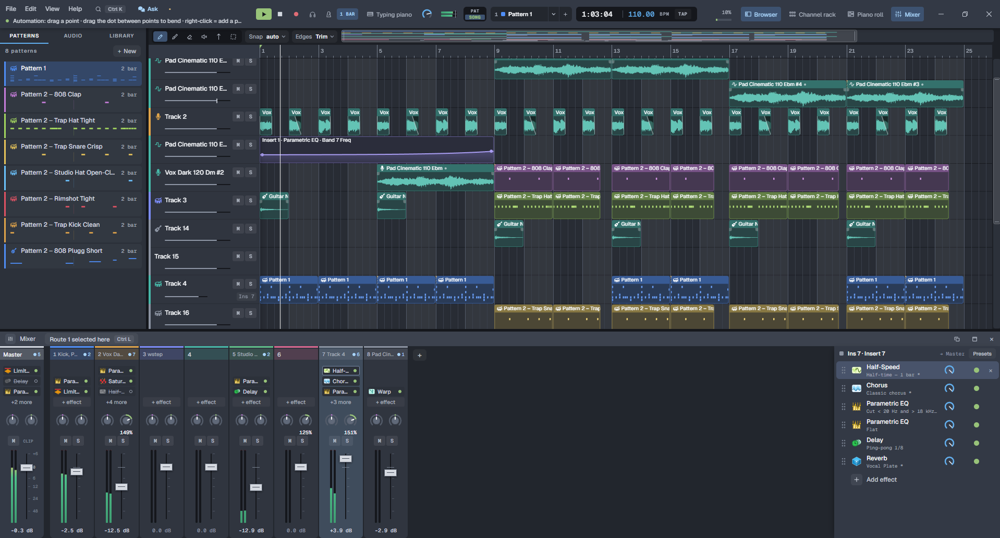
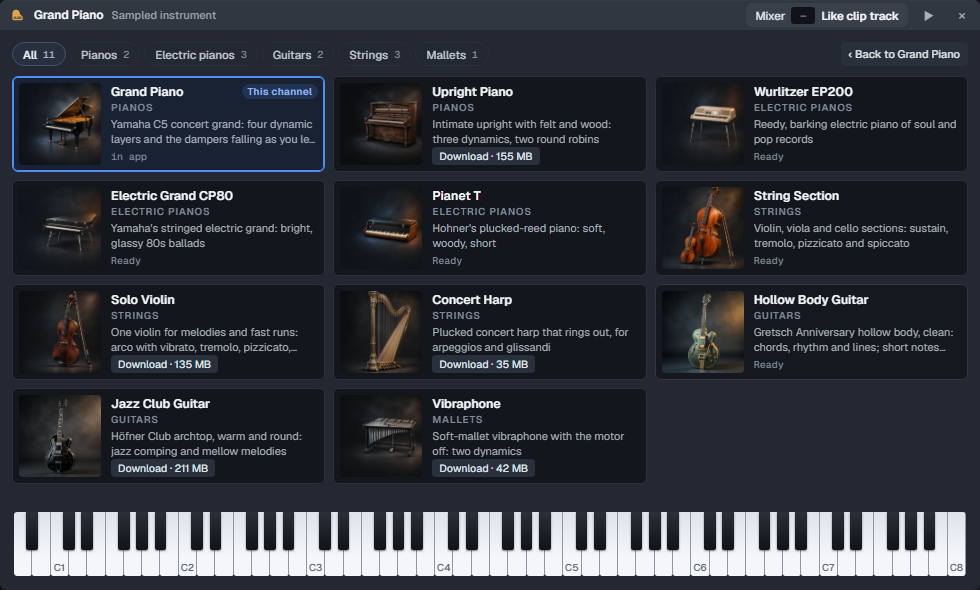
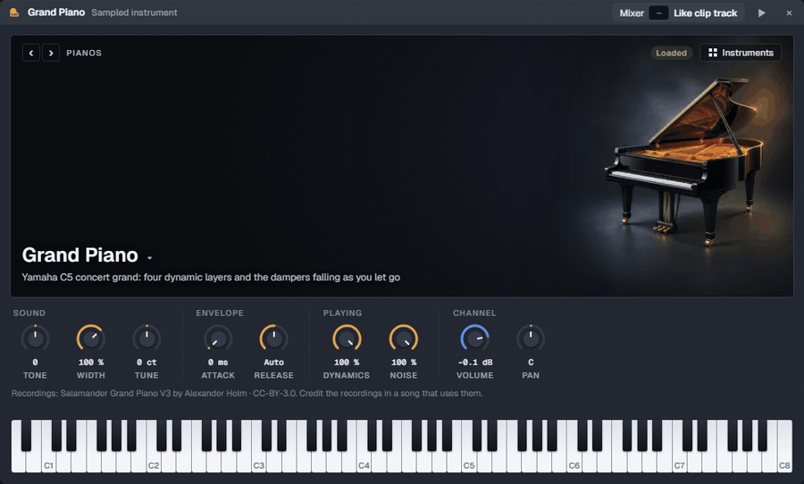
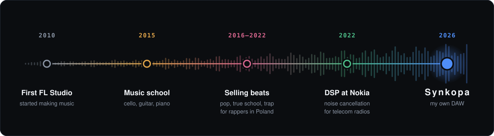

<p align="center"></p>
<h1 align="center">Synkopa</h1>
<p align="center">
  A free, open-source DAW for Windows, macOS and Linux that works the FL Studio way:<br>
  patterns, Channel Rack, piano roll, playlist, audio recording, vocal tuning, offline stems &amp; chords, and a live CLI for scripts and AI agents.
</p>
<p align="center">
  <a href="https://github.com/miskibin/synkopa/releases/latest"><b>Download</b> (Windows, macOS, Linux)</a> ·
  <a href="https://www.youtube.com/watch?v=wtuHDyIQpYk">Watch the video</a> ·
  <a href="https://miskibin.github.io/synkopa/">Hear a beat made in it</a> ·
  <a href="docs/cli.md">Command line</a> ·
  <a href="https://discord.gg/zHMjE3fCY">Discord</a>
</p>
<p align="center">
  <a href="https://github.com/miskibin/synkopa/releases/latest"></a>
  <a href="https://github.com/miskibin/synkopa/actions/workflows/ci.yml"></a>
  <a href="LICENSE"></a>
  <a href="https://discord.gg/zHMjE3fCY"></a>
</p>

[](https://www.youtube.com/watch?v=wtuHDyIQpYk)

Synkopa is a desktop digital audio workstation (DAW) written in Rust (audio engine) and TypeScript/SolidJS (UI, via Tauri 2), released under AGPL-3.0. One free build covers the full song loop—making a beat in the FL Studio pattern workflow, recording and tuning vocals, separating stems, mixing with 21 built-in effects, and exporting stems or mixes—offline, with no account and no paywalled editions.

## Why Synkopa

**If you know FL Studio, you already know Synkopa.** Patterns on a free playlist, a Channel Rack with a step sequencer, a piano roll per channel, and a mixer that docks or floats (`F9`). The gestures match too: right-click deletes, middle-button drag pans, `Ctrl+Q` quantizes, `Alt+wheel` changes velocity, `Alt+T` adds time markers. A beat plays on the first press of Space.

**Recording, vocals, stems and chords are all in the one free build.** Loop recording with takes and comping, measured latency compensation, a note-level pitch editor, live pitch correction, Tune to Reference (pull a take onto a guide vocal), vocal rider, and one-command Auto Vocal. Offline models (downloaded on demand, MIT-licensed) also extract stems onto tracks below a clip (HTDemucs) and detect chords from audio directly into the piano roll with smooth voice leading (ChordMini).

**Eleven sampled instruments, a wavetable synth, and a slice-mode sampler.** [Synkopa Instruments](docs/keys.md) ships with a bundled Yamaha C5 concert grand and ten one-click downloads from open and public-domain recordings—upright piano, Wurlitzer EP200, Electric Grand CP80, Pianet T, String Section (with keyswitches and automatic short/long articulation switching), Solo Violin, Concert Harp, Hollow Body Guitar, Jazz Club Guitar, and Vibraphone—all inside one unified player.

<table>
  <tr>
    <td width="50%"><br><b>Synkopa Instruments library.</b> Grand Piano is bundled in the app; 10 more acoustic, electric, guitar and string instruments download on demand from open recordings.</td>
    <td width="50%"><br><b>One player for every instrument.</b> Shared controls, playable range shading, and automatic or keyswitch articulations on strings and guitars.</td>
  </tr>
</table>

**Every effect draws what it does to your audio.** All 21 built-in effects share one UI language and draw directly from the live audio signal—so you see gain reduction, transfer curves, added harmonics, and reverb tails instead of guessing. These were recorded in the app while a beat plays:

<table>
  <tr>
    <td width="50%"><br><b>Compressor</b> on the drum bus. Left: the transfer curve with the threshold. Right: the level history, with the gain reduction drawn in red from the top.</td>
    <td width="50%"><br><b>Limiter</b> on the master, pushed 7 dB into a −1 dBTP ceiling. The red band is what it takes off each peak.</td>
  </tr>
  <tr>
    <td><br><b>Saturator</b> on the drums. The trace is input against output on the transfer curve; the pink layer in the spectrum is the harmonics the stage adds.</td>
    <td><br><b>Reverb</b> on the piano. Each line is the tail at a later moment, across the spectrum; the orange surface is the decay the knobs ask for.</td>
  </tr>
  <tr>
    <td colspan="2"><br><b>Parametric EQ</b> on the master. The spectrum before and after moves under the curve you drag.</td>
  </tr>
</table>

A selection of instrument and effect windows is on the [website](https://miskibin.github.io/synkopa/#plugins).

## Measured speed vs FL Studio

The Rust audio callback never allocates, locks, or touches a file (a benchmark counts allocations on the audio thread: zero). Moving a knob never rebuilds the audio graph. Sixteen synth voices with two oscillators and seven-voice unison each, every effect on, take about 17% of one core at 48 kHz with 64-sample blocks, and the oscillators stay more than 60 dB above their aliasing up to C7 ([synth measurements](docs/synth.md), [`docs/architecture.md`](docs/architecture.md)).

To measure what a musician actually waits for on desktop, [`perf/realworld/bench.py`](perf/realworld/README.md) drives both apps with real OS input and DXGI frame capture on matched-size projects (~89 channels, 82 patterns, ~5,500 notes, ~120 native effects, Windows 11, i5-12400F, 144 Hz, 2026-11-16, medians):

| Real-world task | Synkopa 0.9 | FL Studio 20.7.2 |
| --- | ---: | ---: |
| Cold startup (launch to idle UI) | 1.32 s | 1.64 s |
| Open a large project | 0.44 s | 10.57 s |
| Open piano roll (`F7`) | 39 ms | 639 ms |
| Add an effect and open its UI | 59 ms | 575 ms |
| Move clips (input → screen, median / p95) | 17 / 25 ms | 16 / 18 ms |
| Audio dropouts during 10 min of editing (512-sample buffer) | 0 | 0 |

*Note on fairness:* FL Studio's demo (*WiseLabs – Nahash*) uses native Harmor patches that cost more to load than Synkopa's synth presets, and FL Studio is slightly ahead on raw clip-drag latency. Full methodology, hardware specs, and reproducible scripts are in [`perf/realworld/README.md`](perf/realworld/README.md).

## Install

Download installers and packages from the [latest release](https://github.com/miskibin/synkopa/releases/latest):

| Platform | Package | Audio & plugins | Notes |
| --- | --- | --- | --- |
| **Windows** | Installer (`.exe` / `.msi`) | WASAPI, ASIO; VST3 instruments & effects | Bundled Grand Piano; associates `.synkopa` files in Explorer |
| **Linux** | `.deb`, `.rpm`, `.AppImage` | ALSA, JACK (incl. PipeWire JACK); VST3 instruments & effects, LV2 effects | `.deb`/`.rpm` pull `liblilv` for LV2; AppImage uses system `liblilv` if installed |
| **macOS** | `.dmg` (Apple Silicon, macOS 13.4+) | Core Audio; built-in instruments & effects | Not notarized yet (first launch: System Settings → Privacy & Security → **Open Anyway**); no VST3 hosting or Intel build yet |

**Windows ASIO note:** If a Focusrite USB interface is disconnected, use **Switch to WASAPI** in the audio notification or Settings → Audio to resume playback through the default output, then switch back to ASIO when reconnected. With Focusrite USB ASIO installed, Synkopa waits for Windows to detect the interface before probing ASIO drivers.

**Sharing projects:** Choose **File → Export project as ZIP** to bundle the `.synkopa` project together with its samples and recorded takes. Unzip the whole archive and keep the `Audio` folder beside the `.synkopa` file. Third-party plugins are resolved from the paths/URIs on the recipient's machine, and files loaded inside a third-party plugin are not collected into the ZIP.

## The `synkopa` command line & AI agents

Synkopa installs a `synkopa` CLI that talks to the running desktop app over a local socket—or edits and renders `.synkopa` project files headless with `-p song.synkopa` (no GUI required). An external agent such as Claude Code or your own script can inspect the project as JSON, write notes, route sidechains, extract chords or stems, run Auto Vocal, bounce offline, and read back peak, LUFS, and clipping statistics to verify its own work. Every command is one step in your undo history, so `Ctrl+Z` removes anything you do not like. [This trap beat](https://miskibin.github.io/synkopa/#listen) was made that way.

```sh
synkopa context --pretty                                # tracks, inserts, patterns, channels, markers
synkopa chords --clip 5012 --to-pattern                 # detect chords from audio -> piano roll
synkopa pattern --id 2 --ch hat --steps "x.x. x.x. x.x5 x.x9"
synkopa sidechain --from 1 --to 3                       # duck bass (insert 3) from kick (insert 1)
synkopa auto-vocal --clip 412 --beat-clip 300           # measure vocal, build FX chain & bake rider
synkopa render --out check.wav --to 16                  # offline bounce + peak/LUFS/clipping stats
synkopa undo                                            # or press Ctrl+Z in the app
```

The CLI works as soon as the app has run once (open a new terminal). Start any coding agent in any folder and tell it to run `synkopa context`. Full reference: [`docs/cli.md`](docs/cli.md).

## How Synkopa fits next to other DAWs

Synkopa borrows FL Studio's workflow, so that is the primary comparison. FL Studio has more than twenty-five years behind it and wins on ecosystem and breadth.

| | Synkopa 0.9 | FL Studio |
| --- | --- | --- |
| Price | Free (one build, no account) | About $99 to $450 depending on edition |
| Source code | Open (AGPL-3.0) | Closed |
| Platforms | Windows, macOS (Apple Silicon), Linux | Windows, macOS |
| Audio recording & comping | Included | Producer edition or higher |
| Vocal pitch editing | Included (pitch editor, live tune, Tune to Reference, Auto Vocal) | NewTone and Pitcher in higher editions |
| Stems & chord detection | Included offline (HTDemucs stems, ChordMini chords → piano roll) | Stem separation in Producer+; chord tools in Piano Roll |
| Built-in instruments & effects | Wavetable synth, 11 sampled instruments, sampler, 21 effects | More than a hundred across editions |
| Third-party plugins | VST3 instruments & effects (Win/Linux); LV2 effects (Linux) | VST/VST3/AU/CLAP and native formats |
| Automation & AI agents | Local CLI (`synkopa`) edits open project + measures renders | No CLI into the open project |
| Maturity | Version 0.9, active development; expect rough edges | Since 1998, huge community, tutorials, sample packs |

*FL Studio details as of November 2026; see Image-Line's edition comparison for current prices. FL Studio is a trademark of Image-Line, and Synkopa is not affiliated with it.*

**Comparing with other free & open-source DAWs:**

- **LMMS:** Also uses an FL Studio-style pattern and beat/bassline workflow, but does not record audio. Choose Synkopa if you want that pattern workflow together with audio recording, comping, vocal pitch editing, VST3/LV2 support on Linux/Windows, and a modern Rust engine.
- **Nota:** Another free, open-source cross-platform desktop DAW (C++20 / Avalonia / JUCE). Nota follows a traditional linear track-based workflow; choose Synkopa if you prefer FL Studio's pattern / Channel Rack / free playlist model, built-in vocal tuning and offline stems/chords, or a scriptable live CLI.
- **Ardour:** Mature open-source DAW built around traditional multitrack studio recording, mixing, and post-production. Choose Ardour for large acoustic/band recording sessions or film post; choose Synkopa for fast FL-style beatmaking and vocal production.
- **Ableton Live / Bitwig Studio:** The arrangement view feels familiar, but Synkopa has no Session view or clip launcher yet. If you compose or perform by launching clips, Synkopa does not replace Live or Bitwig.
- **Browser DAWs:** Synkopa is a native desktop app with direct ASIO/WASAPI/JACK/Core Audio I/O, local file storage, native VST3/LV2 hosting, and offline operation—no browser audio sandbox or subscription.

## What is in the box

| Area | Included in the single free build |
| --- | --- |
| **Arranging** | Pattern, audio, and automation clips on free lanes; slice, fade, reverse, normalize; edge time-stretching (`Shift+M`, pitch-preserving or resampled); on-clip automation curves; export selected clips or loop range in place; named timeline markers (`Alt+T`) to jump between and loop song sections |
| **Writing** | Step sequencer with swing, velocity, key, pan, and shift lanes; piano roll with scale guides and vocal pitch reference; typing keyboard and MIDI keyboard input; MIDI import and export |
| **Instruments** | Two-oscillator wavetable [synth](docs/synth.md) (unison, mod matrix, 46 presets); [Synkopa Instruments](docs/keys.md) (11 sampled instruments: Grand Piano bundled + Upright, Wurlitzer, CP80, Pianet T, String Section, Solo Violin, Harp, Hollow Body & Jazz Guitars, Vibraphone); Music Box; slice-mode sampler (chop at transients or equal slices, dump to pattern) with built-in drum/tonal library and downloadable CC0 kits |
| **Mixing (22 effects)** | 24-band dynamic EQ, compressor, FET compressor, gate, resonant filter, [saturator](docs/saturator.md), delay, [reverb, limiter](docs/reverb-limiter-v2.md), de-esser, denoiser, pitch correction, voice, vocal rider, halftime, warp, chorus, phaser, stereo imager with bass mono, OTT-style multiband, a Master that listens to the whole song and masters it to a loudness target, loudness analyzer (LUFS, true peak); sidechain routing (`Sidechain to →` with ghost-kick option); saved mixer FX chains; dockable/floating/maximizable mixer (`F9`); insert-to-insert routing and plugin delay compensation |
| **Recording & vocals** | Loop recording with takes and comping, measured latency compensation, live monitoring; note-level pitch editor, live pitch correction, Tune to Reference, vocal rider, one-command Auto Vocal |
| **Offline audio tools** | Local stem separation (HTDemucs, 90 MB MIT) extracting stems onto tracks below the clip; local chord detection (ChordMini, 17 MB MIT) sending voiced chords straight to a piano roll pattern |
| **Plugins & audio I/O** | VST3 instruments and effects (Windows & Linux); LV2 effects (Linux); native plugin editor windows on Windows and Linux where supported, otherwise Synkopa's parameter UI; out-of-process plugin scanning; WASAPI and ASIO (Windows), ALSA and JACK / PipeWire JACK (Linux), Core Audio (macOS) |
| **Export & sharing** | Offline bounce of song, loop, or single pattern to 16-/24-bit PCM or 32-bit float WAV, or MP3; mix and per-insert stem export; portable project ZIP export (`File → Export project as ZIP`) |
| **Languages** | English and Polish |

## Product Philosophy

> These rules act as a filter for features, native plugins, factory content, and pull requests.

- **Curated over comprehensive.** One great stock EQ or reverb beats five mediocre ones. Every built-in plugin, preset, and sample must have a distinct musical role and pass a listening test. If a native tool feels like filler, improve or cut it—never pad the list.
- **Shared project context, backed by DSP.** The DAW already knows the tempo, key, track routing, and audio signal. Native tools should use that state automatically—tempo matching, scale guides, vocal tuning key, and DSP-based mix checks—always with A/B preview and one-click dismissal. Keep AI automation in the CLI and external agents, not in a chat sidebar.
- **Automate the housekeeping.** Track naming, coloring, mixer routing, and crash-safe autosave should happen without manual setup. Treat unnecessary dialogs, window switches, and lost sessions as bugs.
- **Built to finish songs.** Pattern-based beatmaking is only half the workflow. Recording, comping, vocal tuning, mixing, and mastering belong in the same app so a track can go from loop to export without switching DAWs.
- **One UI language.** Native plugins share the same layout rules, controls, shortcuts, and metering. Visuals exist to show what the audio is doing—clear curves and meters over skeuomorphic knobs.
- **Local-first and open.** Free, open-source, offline by default, and scriptable via CLI. No accounts, no subscriptions, no paywalled core features.

**Non-goals before 1.0:** duplicate synths or effects, built-in AI song generators, in-app chatbots, DJ modes, and feature-checklist parity with legacy DAWs.

## Note from developer



- **2010:** I downloaded FL Studio for the first time and started making music.
- **2015:** I started music school: cello, guitar and piano (graduated in 2019).
- **2016–2022:** I sold beats to underground rappers in Poland (pop, true school, trap, love songs).
- Along the way I tried almost every genre (EDM, lo-fi, classical, my own pop songs), often with real instruments in my beats. I also run a YouTube channel and master the voice for it myself.
- **2022:** I joined Nokia, where I work on noise cancellation for telecom radios. That is a lot of DSP math, so I understand how sound works under the hood.

Synkopa started as a fun experiment. I wanted a modern DAW where every instrument and effect feels like part of the same application: they share the same controls and visualizations, a new feature reaches the whole app at once, and you don't juggle a dozen different interfaces. Yes, it is vibe-coded with Claude Fable, but I know what the code is doing.

There are already excellent open-source DAWs, and I'm not trying to replace them. I just wanted a different workflow, and ended up using Synkopa more than FL Studio itself.

## Where it stands

Version 0.9, developed openly with community contributors and AI-assisted coding. It covers a complete beat and vocal session. What it does not do yet:

- no LV2 instruments or CLAP support yet (VST3 instruments and effects are supported on Windows and Linux); some Linux plugin UIs fall back to Synkopa's parameter list when their native toolkit cannot be hosted;
- LV2 on Linux requires `liblilv` (`liblilv-0-0` on Debian/Ubuntu, `lilv-libs` on Fedora): `.deb` and `.rpm` install it; the AppImage uses it when present and tells you what to install if not. LV2 plugins requiring an unsupported host feature (such as a fixed block size) are listed with the reason;
- on macOS: Apple Silicon and macOS 13.4+ only, no VST3 hosting yet, and not yet notarized (see Install);
- no Session view or clip launching;
- no import of FL Studio projects (`.flp`); bring stems, MIDI, or samples over instead;
- releases ship often, so things still evolve. The [changelog](CHANGELOG.md) is written for musicians, not developers.

Found a bug or miss something from FL? [Open an issue](https://github.com/miskibin/synkopa/issues).
Questions, beats and feedback: join the [Synkopa Discord](https://discord.gg/zHMjE3fCY).

## FAQ

**Can I release and sell music made in Synkopa?**
Yes. AGPL-3.0 covers Synkopa's source code, not the audio, stems, or MIDI you export. Everything you render with the wavetable synth, built-in effects, factory kits, and CC0 instruments requires no attribution. A few sampled instruments in Synkopa Instruments use CC-BY-3.0 recordings; when one does, the exact credit is shown inside that instrument's window and in [`THIRD_PARTY_NOTICES.md`](THIRD_PARTY_NOTICES.md).

**Can Synkopa replace FL Studio on Linux, Windows, or macOS?**
For beatmaking, audio recording, vocal tuning, and mixing with built-in tools and compatible VST3/LV2 plugins, it covers the core FL Studio workflow—including on Linux, where FL Studio has no native build. It cannot open `.flp` project files or run FL Studio's proprietary stock plugins, and macOS (Apple Silicon, 13.4+) does not host third-party VST3 plugins yet.

**Which audio interfaces, MIDI controllers, and third-party plugins are supported?**
Audio I/O uses WASAPI and ASIO on Windows, ALSA and JACK (including PipeWire's JACK) on Linux, and Core Audio on Apple Silicon macOS, with duplex recording and measured latency compensation. Standard MIDI keyboards and controllers work for live input and recording. Plugin hosting covers VST3 instruments and effects on Windows and Linux, plus LV2 effects on Linux (via `liblilv`), with out-of-process scanning and plugin delay compensation. CLAP, LV2 instruments, and macOS VST3/AU are not supported yet.

**Do stem separation, chord detection, and vocal tuning work offline without an API key?**
Yes. Synkopa is offline by default, with no account, subscription, or cloud API. Stem separation (HTDemucs, ~90 MB, MIT), chord detection to piano roll (ChordMini, ~17 MB, MIT), and pitch analysis run locally on your machine after a one-time on-demand model download.

**How does AI agent or script control work—and do I need AI to use Synkopa?**
You do not need an AI agent; Synkopa is a normal desktop DAW operated with mouse, keyboard, and MIDI. The optional `synkopa` CLI connects to the running app over a local socket (or runs headless on `.synkopa` files via `-p`), letting scripts or coding agents read the project as JSON, edit patterns/routing/FX, and verify changes through offline renders with peak, LUFS, and clipping stats. Every CLI edit is a single `Ctrl+Z` undo step.

**How is audio stability verified if much of the codebase is AI-assisted?**
The project is directed by a musician who works professionally in telecom DSP, with open-source contributors. Every change runs automated engine tests for clicks, aliasing, and loudness, alongside a real-time benchmark verifying zero allocations on the audio callback and reproducible desktop latency/dropout timings against FL Studio ([`perf/realworld/README.md`](perf/realworld/README.md)).

## Build from source

Prerequisites: Rust stable, Node 22 + pnpm, and on Linux the WebKitGTK, ALSA, JACK and D-Bus dev packages (`libwebkit2gtk-4.1-dev libasound2-dev libjack-jackd2-dev libdbus-1-dev`). JACK is loaded at run time, so the app still starts on a machine without it.

```sh
pnpm --dir ui install
cargo install tauri-cli --version "^2"
cd app && cargo tauri dev
```

**ASIO (Windows):** build with the `asio` feature. It needs LLVM/Clang (`winget install LLVM.LLVM`, then `LIBCLANG_PATH=C:\Program Files\LLVM\bin`); cpal downloads the Steinberg SDK automatically.

```powershell
cd app; cargo tauri build --features asio
```

**Synkopa Instruments in your own build:** `node scripts/fetch-keys.mjs` downloads the Grand Piano (138 MB, checksummed, cached in `target/keys-src`) and prepares it in `app/resources/keys` (trimmed to played range, 16-bit FLAC, ~23 MB) so `tauri build` bundles it. Requires `cargo`. Without it, the app offers to download the piano on first use.

**ONNX Runtime on Linux:** loaded on demand for pitch, chord, and stem models. Run `node scripts/fetch-onnxruntime.mjs` to place Microsoft's checksummed library into `app/resources/ort` before `tauri build` (or point `ORT_DYLIB_PATH` at `libonnxruntime.so` 1.20+). Without it, pitch detection falls back to the built-in YIN detector.

## Layout

| path | what |
| --- | --- |
| `crates/engine` | project model, ops + undo, sequencer, synth and sampled-instrument voices, 21 built-in DSP effects, mixer graph, recording, offline render, analysis |
| `crates/audio-io` | cpal devices: WASAPI / ASIO / CoreAudio / ALSA / JACK, duplex in/out |
| `crates/chords` | local chord detection (ChordMini + CQT) and voice-led piano roll export |
| `crates/vst3-host`, `crates/plugin-windows`, `crates/plugin-scan` | VST3 effects and instruments, out-of-process plugin scanning, native editor windows |
| `crates/lv2-host` | LV2 effects as engine processors on Linux (liblilv opened at run time): metadata scan, worker thread, state, latency |
| `crates/audio-file` | WAV/AIFF/FLAC/OGG/MP3 decoding |
| `crates/session`, `crates/cli` | the local socket the CLI uses, and the `synkopa` CLI itself |
| `app` | Tauri shell: commands, library & model downloads, settings, CLI launcher |
| `ui` | SolidJS + TypeScript frontend (also runs in a browser with a mock backend) |
| `perf` | audio-thread benchmarks and real-world desktop timings vs FL Studio |
| `site` | the landing page published to GitHub Pages |

## Tests

```sh
cargo test --workspace
pnpm --dir ui test
cargo run -p wave-engine --example bench --release   # callback load, heavy mixer
```

## Credits

Special thanks to [@rebizu](https://github.com/rebizu) for architectural reviews, engine/mock parity tests, the Piano Roll tool refactor and ongoing plugin UX work. Thanks to everyone contributing code, reviews and bug reports. See the [contributors](https://github.com/miskibin/synkopa/graphs/contributors).

Third-party components and sample credits are in [`THIRD_PARTY_NOTICES.md`](THIRD_PARTY_NOTICES.md).

<a href="https://upstar.dev/r/miskibin/synkopa"><picture><source media="(prefers-color-scheme: dark)" srcset="https://upstar.dev/badge/miskibin/synkopa/rank-card-dark.svg"></picture></a>

[](https://deepwiki.com/miskibin/synkopa)

[](https://www.greptile.com/?utm_source=oss_badge&utm_medium=readme&utm_campaign=greptile_for_open_source)
