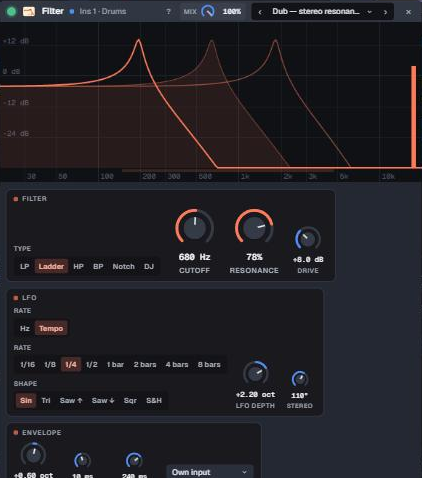

# Filter

The Filter is a resonant low-pass, high-pass, band-pass, notch, ladder or DJ filter whose cutoff
can move on its own, with an LFO, with the level of the sound, or with the level of another
track: for build-ups, wah, auto-wah, pumping and DJ transitions.

## Quick start

1. Add **Filter** to an insert (mixer, `F9`, then **+ effect**).
2. Pick a **Type**. **Ladder** (the default) is a warm low-pass that growls when pushed; **LP**,
   **HP** and **BP** are clean.
3. Turn **Cutoff** to set where the filter acts, and **Resonance** for a peak at the cutoff.
4. To make it move, set **LFO depth** (in octaves), or record automation of **Cutoff**.

## Choose a filter type

| Type | What it does |
|---|---|
| **LP** | Low-pass: removes the highs above the cutoff |
| **Ladder** | Low-pass with a warm, saturating character; self-oscillates (whistles) near full resonance |
| **HP** | High-pass: removes the lows below the cutoff |
| **BP** | Band-pass: keeps only a band around the cutoff |
| **Notch** | Removes a narrow band around the cutoff |
| **DJ** | One knob from low-pass (left) through off (centre) to high-pass (right) |

**Slope** (12 or 24 dB) sets how steep the LP, HP, BP and Notch types are. Switching the type or
the slope crossfades, so it does not click on a held note.

## Sweep a build-up

Automate **Cutoff** over the bars before a drop. With **HP**, the low end drains away; with
**LP** or **Ladder**, the track opens up. The **Build-up — high-pass (4 bars)** preset uses the
LFO synced to the tempo instead of automation.

## Make a rhythmic wah

1. In **LFO**, set **Rate** to **Tempo** and pick a note value (1/16 to 8 bars).
2. Pick a **Shape**: **Sin** for a smooth wah, **Sqr** for a hard on/off, **S&H** for random
   steps.
3. Turn up **LFO depth**: how many octaves the cutoff swings.
4. **Stereo** offsets the right side's LFO (up to 180°) for movement across the speakers.

Synced to the tempo, the LFO follows the song position, so the pattern repeats the same way
every time you play the song.

## Auto-wah: follow the playing

**Env depth** moves the cutoff with the level of the sound: louder notes open the filter (or close
it, with a negative depth). **Env attack** and **Env release** set how fast it follows. Try it on
guitar or bass with the **Auto-wah — guitar, bass** preset.

## Pump with the kick

In the **Envelope** section, click **Own input** and pick another insert (the kick). Its level now
moves this filter. Set **Env depth** negative and the filter closes on every kick: the
**Pumping (sidechain from the kick)** preset.

## DJ transitions

Set **Type** to **DJ**. One **Position** knob replaces Cutoff: in the middle the sound passes
untouched, turning left closes a low-pass, turning right opens a high-pass. Automate it for a
transition, or start from the **DJ — transition** preset.

## Controls

| Control | What it does | Try |
|---|---|---|
| **Type** | LP, Ladder, HP, BP, Notch or DJ | Ladder for synths |
| **Slope** | 12 or 24 dB/oct (not on Ladder) | 24 dB for a clear sweep |
| **Cutoff** | Where the filter acts (20 Hz–20 kHz) | |
| **Position** | DJ only: low-pass (left), off (centre), high-pass (right) | |
| **Resonance** | Peak at the cutoff; Ladder self-oscillates near the top | 25–60 % |
| **Drive** | Saturates the sound before the filter, level-matched (0–24 dB) | 6 dB for grit |
| **Rate** | LFO speed: **Hz** (0.05–20 Hz) or **Tempo** (1/16 to 8 bars) | Tempo, 1/4 |
| **Shape** | Sin, Tri, Saw ↑, Saw ↓, Sqr, S&H | Sin |
| **LFO depth** | How far the LFO moves the cutoff (±5 octaves) | +2 oct |
| **Stereo** | Right side's LFO offset (0–180°) | 90° for width |
| **Env depth** | How far the level moves the cutoff (±6 octaves) | +2 oct for auto-wah |
| **Env attack**, **Env release** | How fast the level follower reacts (1–200 ms, 10–1000 ms) | 10 ms, 150 ms |
| **Sidechain** (in **Envelope**) | Whose level drives the envelope: **Own input** or another insert | The kick, for pumping |
| **Soft clip** | Under **Advanced**: catches resonant peaks before they clip | On |

## Presets

Warm low-pass (ladder), House — closed low-pass, Build-up — high-pass (4 bars),
Wah — quarter notes, Auto-wah — guitar, bass, Rhythmic filter 1/8, Lo-fi — telephone,
Dub — stereo resonance, Pumping (sidechain from the kick), Acid — 303,
S&H — random 1/16 steps, DJ — transition.

## Common problems

- **A loud whistle at high resonance.** That is the Ladder self-oscillating (from about 96 %).
  Lower **Resonance**, or keep **Soft clip** on to stop the peaks from clipping.
- **The bass gets thinner with resonance.** A resonant ladder loses some low end; the filter
  compensates part of it. Lower **Resonance** or use **LP** with **Slope** 24 dB.

## Technical notes

Code: `crates/engine/src/dsp/filter.rs`; window: `ui/src/views/fx/filter.ts`. The window draws
the response at the set cutoff (outline), the response right now with the LFO and envelope moving
it (left bright, right dim), and the range the modulation can sweep (bar along the bottom).

**Parameter ids** (order = `dsp::filter::idx`):

| id | range | notes |
| --- | --- | --- |
| `type` | LP / Ladder / HP / BP / Notch / DJ | switching type or slope crossfades over 10 ms |
| `cutoff` | 20 Hz – 20 kHz | |
| `res` | 0–100 % | SVF: Q from 0.5 to 64. Ladder: feedback up to 4.15, self-oscillating from about 96 % |
| `slope` | 12 / 24 dB | SVF types only. At 24 dB the first stage is Butterworth and only the second resonates, so Resonance feels the same at both slopes |
| `drive` | 0–24 dB | tanh before the filter with an automatic trim; blends in over the first dB, so 0 dB is exactly clean |
| `dj` | −100…100 % | DJ type only. The middle ±1 % passes the sound bit for bit; the filter fades in over the next 4 %. Left: low-pass from 20 kHz down to 20 Hz; right: high-pass from 20 Hz up to 20 kHz |
| `sync`, `rate`, `div`, `shape` | Hz / Tempo; 0.05–20 Hz; 1/16 … 8 bars; Sine, Triangle, Saw up, Saw down, Square, S&H | synced, the LFO follows the song position and S&H picks the same step at the same bar |
| `lfo` | ±5 octaves | |
| `stereo` | 0–180° | right LFO behind the left |
| `env`, `eatt`, `erel` | ±6 octaves, 1–200 ms, 10–1000 ms | the follower reads the level in dB: −40 dBFS gives 0 and 0 dBFS gives 1 |
| `clip` | Off / On | smooth limiter on the filtered sound, linear up to −3 dBFS, then rising towards 0 dBFS; at the DJ centre nothing is filtered, so nothing is clipped |

- **SVF types.** Zero-delay-feedback state-variable filter with trapezoidal integration
  (A. Simper, V. Zavalishin). Stable and click-free while the cutoff moves every sample. The
  cutoff is pre-warped, so it sits at the same frequency at 44.1–192 kHz.
- **Ladder.** Four one-pole stages with tanh in the feedback path, linearised around the previous
  sample (the "cheap" nonlinear ZDF ladder), so it growls when pushed and self-oscillates without
  running away. The input is raised by half the feedback, so at 85 % resonance the low end loses
  about 6 dB instead of 11.
- **Modulation.** All cutoff movement is in octaves, smoothed per sample over ~20 ms. LFO jumps
  (saw, square, S&H) are rounded over 1.5 ms, so they do not click.
- **Tail.** The host parks a silent effect once its tail has rung out. Near self-oscillation the
  ladder's tail comes from its poles (they decay at (1 − k^¼/√2)·2π·fc), so a 96 % resonance
  reports seconds, not milliseconds; at the edge it reports no tail and keeps running.
- **Latency and oversampling.** None. With drive, aliasing on a 4.1 kHz tone at +12 dB of drive
  into a bright resonant ladder measures 44 dB below the fundamental (48 kHz).
- **Cost.** More than 100× real time in a debug build (the heaviest settings, 10 s at 48 kHz).

**Meters:** `[0]`/`[1]` the cutoff right now, left and right, in Hz; `[2]` the envelope, 0..1;
`[3]` the LFO phase; `[4]` DJ: how much of the filter is heard; `[5]` 1 while the soft clip
works; `[6]` 1 with a sidechain.

The preset names are stored in Polish in the engine and shown translated in the English UI
(`ui/src/i18n/names-fx.ts`).

## See also

- [Gate](gate.md): the other effect that can follow a sidechain.
- [Chorus and Phaser](chorus-phaser.md): other LFO-driven movement.
- [All effects](README.md)
