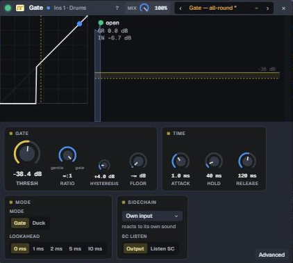

# Gate

The Gate turns a sound down when it gets quiet, which removes noise and bleed between notes and
drum hits; it can also duck one sound under another, or chop a pad in time with a kick or a
hi-hat (a trance gate).



## Quick start

1. Add **Gate** to an insert (mixer, `F9`, then **+ effect**).
2. Play the track and watch the grey level history in the window.
3. Set **Thresh** just above the noise between the notes or hits. The lamp shows **open**,
   **hold** or **closed**.
4. If the end of each note is cut off, lengthen **Release** or **Hold**.
5. If silence between notes sounds unnatural, raise **Floor** to about −14 dB.

## Clean up noise and bleed

A *gate* opens when the sound is louder than **Thresh** and closes when it falls below. Three
controls stop it from chattering (opening and closing rapidly on a decaying note):

- **Hysteresis**: the gate closes only once the level is this far below **Thresh**.
- **Hold**: the gate stays open this long after the level drops.
- **Release**: how fast it closes.

On drums, pick a **Lookahead** of 1–5 ms. The gate then opens just before each hit, so the
attack is not cut. The sound is delayed by that amount and the mixer compensates for it.

**Ratio** sets how hard it closes. At the top (shown as ∞) it is a hard gate. Lower values make a
gentle *expander*: quiet parts are turned down gradually rather than cut, which sounds more
natural on vocals.

## Duck one sound under another

Set **Mode** to **Duck**. The gate now turns the sound *down* (to **Floor**) while its detector
hears something. To duck music under a voice-over, or a bass under the kick:

1. Put the Gate on the track that should get quieter (the music, the bass).
2. In the **Sidechain** box, click **Own input** and pick the insert that should push it down
   (the voice, the kick).
3. Set **Mode** to **Duck**, then set **Thresh** and **Floor**.

The presets **Ducking — bass under the kick** and **Ducking — music under a voice-over** are set
up for this.

## Chop a pad in time with another track (trance gate)

Put the Gate on the pad, and in the **Sidechain** box pick a rhythmic insert (a hi-hat or a
kick). The pad now opens only when that track plays. The **Trance gate (sidechain)** preset is a
starting point.

## Make the gate hear only part of the sound

Under **Advanced**, **SC low cut** and **SC high cut** filter what the detector hears (not the
sound itself). On a snare, cut the lows so the kick bleeding into the snare mic does not open
the gate. Switch **SC listen** to **Listen SC** to hear what the detector hears while you set
the band.

## Controls

| Control | What it does | Try |
|---|---|---|
| **Thresh** | Level that opens the gate (−80 to 0 dB) | Just above the noise |
| **Ratio** | Gentle expander to hard gate (∞) | ∞ on drums, lower on vocals |
| **Hysteresis** | How far below **Thresh** the gate closes (0–24 dB) | 4 dB |
| **Floor** | How far down the gate turns the sound (−∞ to 0 dB) | −14 dB for a natural result |
| **Attack** | How fast it opens (0.1–50 ms) | 1 ms on drums |
| **Hold** | How long it stays open after the level drops (0–500 ms) | 40 ms |
| **Release** | How fast it closes (5–2000 ms) | 120 ms |
| **Mode** | **Gate**, or **Duck** (turns down while the detector hears sound) | Duck for ducking |
| **Lookahead** | 0, 1, 2, 5 or 10 ms early warning; adds that much latency | 2 ms on drums |
| **Sidechain** | What the detector listens to: **Own input** or another insert | |
| **SC listen** | **Output** (normal) or **Listen SC** (hear the detector) | Listen SC while setting the band |
| **SC low cut**, **SC high cut** | Band the detector hears (off at the ends of their range) | Low cut 150 Hz on a snare |
| **Detect** | **Peak** reacts at once; **RMS** ignores clicks | Peak on drums |

## Presets

Gate — all-round, Vocal — natural clean-up, Kick — tight and punchy, Snare — no bleed,
Toms — clean decay, Guitar — no hiss or hum, Expander — gentle, Trance gate (sidechain),
Ducking — bass under the kick, Ducking — music under a voice-over, Gated reverb — 80s snare.

## Common problems

- **The gate chatters on decaying notes.** Raise **Hysteresis** or **Hold**.
- **Drum attacks sound soft.** Use a **Lookahead** of 1–5 ms, or a shorter **Attack**.
- **The mixer's Sidechain to menu did not key my gate.** **Sidechain to** (right-click a mixer
  strip) always works on a Compressor. Key a Gate from its own window's **Sidechain** box.

## Technical notes

Code: `crates/engine/src/dsp/gate.rs`; window: `ui/src/views/fx/gate.ts`. The window draws the
transfer curve (input dB → output dB) on the left and a scrolling history on the right: the
detector level (grey), the gain applied (red, from the top), the open threshold (solid) and the
close threshold (dashed) with the hysteresis band shaded.

**Parameter ids** (order = `dsp::gate::idx`):

| id | range | notes |
| --- | --- | --- |
| `thr` | −80…0 dB | |
| `hyst` | 0–24 dB | |
| `ratio` | 1:1 … ∞:1 | below the close threshold the output drops `ratio − 1` dB for every dB the input drops; the top of the range (100) is a hard gate, shown as ∞ |
| `floor` | −∞…0 dB | the bottom of the range (−80) is silence, shown as −∞ |
| `att`, `hold`, `rel` | 0.1–50 ms, 0–500 ms, 5–2000 ms | attack and release are 10–90 % times |
| `look` | 0 / 1 / 2 / 5 / 10 ms | reported as latency and compensated; not automatable (compensation is planned when the mixer graph is built) |
| `mode` | Gate / Duck | in Duck mode Attack sets how fast it ducks; switching glides from the old gain to the new one |
| `schp`, `sclp` | 20–4000 Hz, 200–20000 Hz | 24 dB/oct band on the detector |
| `det` | Peak / RMS | Peak reacts at once and lets go over 10 ms; RMS over 10 ms |
| `listen` | Off / On | output = what the detector hears, delayed by the look-ahead like the sound; listening to a sidechain keeps the insert awake while its own input is silent |

- **Detector.** It hears the insert's own input, left and right linked (the louder side
  decides), or the sidechain (`Fx.key`).
- **Envelope.** A two-pole, critically damped curve with no overshoot and no corner. Opening is
  smoothed in linear gain, closing in dB. Even a 0.1 ms attack does not click. Measured on a
  gated 100 Hz tone, high-passed at 4 kHz: edge splatter stays under −65 dBFS at a 2 ms attack and
  under −50 dBFS at 0.5 ms.
- **States.** Closed → open (at `thr`) → hold (below `thr − hyst`, for `hold` ms) → closing →
  closed.
- **Cost.** About 25× real time in a debug build and several hundred × in release (10 s at
  48 kHz on one core).

**Meters:** `[0]` the detector's level in dBFS (peak or RMS, as `det` picks), `[1]` the gain in
dB, `[2]` the state (0 closed, 1 open, 2 hold, 3 closing), `[3]` 1 while it listens to a
sidechain.

**Command line.** Add a trance gate on insert 3, then let the kick on insert 1 drive it (preset
indexes start at 0):

```
synkopa add-fx --insert 3 --type gate --preset 7
synkopa sidechain --fx ID --from 1
```

## See also

- [Filter](filter.md): the other effect that can follow a sidechain.
- [Compressor](compressor.md): classic sidechain ducking (**Sidechain to** in the mixer).
- [All effects](README.md)
