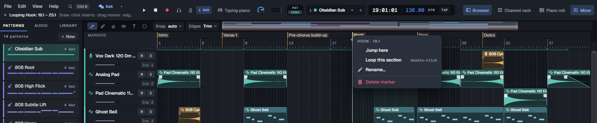

# Arranging

How to turn patterns and recordings into a whole song on the Playlist: placing and editing clips,
audio clips and time-stretching, automation, markers and where the song ends.

## Quick start

1. Make a pattern current (pattern selector, number pad `1`–`9`, or the Browser's **PATTERNS**).
2. Press `P` and click a track: a clip of that pattern appears. Press `B` and drag to repeat it.
3. Drag audio from the Browser or your file manager onto a track for an audio clip.
4. Press `Alt+T` at the start of each section and name it (Intro, Verse, Hook).
5. Press Space in SONG mode to play the arrangement.

## The Playlist tools

| Tool | Key | What it does |
| --- | --- | --- |
| **Draw** | `P` | Click inserts the current pattern or sample; drag moves a clip; drag an edge to trim |
| **Paint** | `B` | Drag to repeat clips, in any direction and across tracks |
| **Delete** | `D` | Click or drag over clips to delete them |
| **Mute** | `T` | Click a clip to mute or unmute it |
| **Slice** | `C` | Click cuts a clip; drag up or down cuts every track the line crosses; `Alt` = off the grid |
| **Select** | `E` | Drag a rectangle to select |

Whatever the tool:

- **Right-click** a clip below its name bar to delete it; right-drag deletes everything it crosses.
  **Right-click the name bar** opens the clip's menu.
- `Ctrl`+drag selects with a box, `Ctrl`+click adds or removes a clip, `Shift`+drag copies.
- Hold `Alt` while dragging to move off the grid. **Snap** above the tracks sets the grid.
- Middle-button drag pans the view. `Ctrl`+wheel zooms; `Page Up` / `Page Down` zoom at the pointer;
  `Shift+1` / `2` / `3` are zoom presets and `Shift+4` fits the whole song. `Ctrl`+right-drag zooms to
  a range, `Ctrl`+right-click goes back to the previous view.

Clicking a pattern clip makes its pattern current, so the next Draw click places that pattern.
Double-click a pattern clip to open it in the Channel rack.

## Edit clips

| Key | What it does |
| --- | --- |
| `Ctrl+B` | Duplicate the selection after itself |
| `Ctrl+C` / `Ctrl+X` / `Ctrl+V` | Copy, cut, paste |
| `Delete` | Delete the selection |
| `Alt+M` | Mute or unmute the selection |
| `Shift+←` / `→` | Move the selection one grid step |
| `Shift+↑` / `↓` | Move the selection one track |
| `Ctrl+A` / `Ctrl+D` | Select all / deselect |

The clip menu (right-click the name bar) has **Rename** and colour (they change the pattern or
sample itself, so every clip of it follows), **Duplicate**, **Clipboard**, **Split** (here, or at
the playhead), **Make unique** (a separate copy of the pattern or sample), **Export in place**,
**Mixer channel…** and **Select all from this source**.

Clips may overlap on a track, for layers and crossfades. Where they do, the track header is hatched
and a clip that hides others shows "×2", "×3".

### Tracks

Drag a track header up or down to reorder it; its clips, name, colour, volume and routing move
with it. Double-click the name to rename it. Right-click the header for **Mute**, **Solo**,
**Record into this track**, **Mixer channel**, **Select track clips**, **Insert track above /
below** and **Delete track**. The **Ins** button beside the volume shows the track's mixer insert:
click to change it, double-click to show it in the mixer.

## Work with audio clips

Drop a WAV, MP3, FLAC, OGG or AIFF file onto a track. Double-click an audio clip for its **sample
editor**: region, fades, **VOL**, **PAN**, **PITCH** (±12 semitones, length kept), **FINE**,
normalize, reverse, its own mixer insert, and **Fit to** 1 or 2 beats or 1–8 bars.

- Drag the small handles near the clip's top corners to fade it in or out.
- All clips of one sample share its sound (volume, pan, pitch, insert). **Make unique** gives one
  clip its own copy.
- **Add as sampler channel** (clip menu) puts the sound in the Channel rack so you can play it from
  the keyboard.

### Fit a loop to the tempo (stretch)

Press `Shift+M` (or switch **Edges** from **Trim** to **Stretch** above the tracks). Dragging an
audio clip's edge now makes it play slower or faster, ×0.25 to ×4, instead of trimming it. The
pitch is kept; choose **Resample** in the clip menu for a turntable-style change where pitch follows
speed. `Shift+M` switches back to trimming. The stretch renders in the background; until it is
ready the clip plays resampled.

To set the project tempo from a sample instead, right-click the clip → **Detect tempo, key and
chords…** and use **Set tempo**.

## Automate a control

Right-click any knob, fader or slider → **Automate on the playlist**. Synkopa makes an automation
clip on the Playlist (4 bars long, or the loop range when one is set). Edit it right on the Playlist, without a mode:

- drag a point (`Shift` locks the value, `Ctrl` the time, `Alt` skips the snap);
- drag the dot halfway along a segment to bend it;
- right-click empty space to add a point, right-click a point for its menu (type a value, choose a
  curve: **Single curve**, **Double curve**, **Hold**, **Stairs**…, or delete it);
- double-click a point to delete it, a bend dot to straighten it;
- `Ctrl`+drag selects points; `Delete` removes them.

**Record knob moves:** right-click the record button and tick **Automation**. With the song
playing, turn a knob and the move is written into its automation clip, one undo step per move.
**Latch** keeps writing the last value until the song stops. Moving an automated control by hand
while it plays takes over from the envelope (the knob shows a grey mark); right-click it →
**Re-enable automation**, or stop, to hand it back.

## Mark the sections of the song

Markers are labels on the timeline, like FL's time markers. They appear in a strip above the ruler.

- `Alt+T` adds a marker at the song position (the playhead while playing) and asks for its name.
  Right-click the ruler → **Add marker here** does the same at the pointer.
- Click a marker to jump there; drag it to move it (`Esc` puts it back).
- Double-click a marker to **Loop this section** up to the next marker.
- Right-click a marker to rename or delete it.
- `Alt+→` / `Alt+←` (or `Alt+Num *` / `Alt+Num /`) jump to the next or previous marker, also while
  playing. **Edit → Markers** lists them all, and `Ctrl+K` finds them by name.

## Loop a part and set the start position

On the time ruler:

- **Click** sets the start position (where Space plays from).
- **Drag** draws a loop; drag a loop edge to resize it; `Shift`+drag inside the loop moves it.
- **Right-drag** draws a loop too; with a loop set, right-click moves its nearer end to the pointer.
- `Ctrl`+drag moves the start position; **double-click** removes the loop.

The song position slider under the transport moves the playhead as well (`←` / `→` a bar,
`Shift+←` / `→` a beat, `Home` / `End`).

## Where the song ends

In SONG mode playback wraps, and a song export stops, at the end of the bar where the last clip
ends. A clip that runs less than a sixteenth into the next bar (an audio file a hair too long) does
not add that bar.

## Bounce parts to audio

- **Export in place** (`Ctrl+Alt+E` or the clip menu): the selected clips, with their mixer effects,
  become one audio clip on a new track below; the originals are muted.
- **File → Export loop range in place:** only what plays inside the loop becomes audio; clips
  crossing its edges are split so the parts outside keep playing.

## See also

- [Making beats](making-beats.md) for writing patterns.
- [Recording vocals](recording-vocals.md) for takes and comping.
- [Stems and chords](stems-and-chords.md) for splitting a song into tracks.
- [Exporting](exporting.md) and [Shortcuts](shortcuts.md#playlist).
