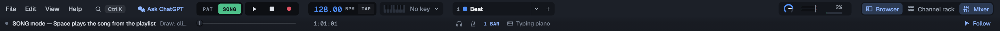

# Getting started

This tutorial takes you from installing Synkopa to an exported MP3 of your first beat (drums and a
bass line) in about ten minutes.

If you know FL Studio, most of this will feel familiar: patterns, a Channel Rack with a step
sequencer, a piano roll, a free Playlist and a mixer, with the same keys (`F6`, `F7`, `F9`, `F5`,
Space, `L`).

## 1. Install Synkopa

Download the package for your system from the
[latest release](https://github.com/miskibin/synkopa/releases/latest).

| System | Package | Notes |
| --- | --- | --- |
| Windows | Installer (`.exe` or `.msi`) | Plays through WASAPI or ASIO. The Grand Piano is included. `.synkopa` files open from Explorer. |
| Linux | `.deb`, `.rpm` or `.AppImage` | Plays through ALSA or JACK (PipeWire's JACK works). The `.deb` and `.rpm` also install `liblilv`, which LV2 plugins need. |
| macOS | `.dmg` (Apple Silicon, macOS 13.4 or newer) | Plays through Core Audio. Built-in instruments and effects only: VST3 plugins are not hosted on macOS yet, and there is no Intel build. |

### macOS: the first launch

Synkopa is not notarized by Apple yet, so macOS blocks it the first time.

1. Open the `.dmg` and drag Synkopa to Applications.
2. Start Synkopa once. macOS says it cannot be opened.
3. Open **System Settings → Privacy & Security**, scroll down and click **Open Anyway**.
4. Start Synkopa again and confirm. From now on it opens normally.

### Updates

Synkopa updates itself on every system. A new version downloads in the background; when it is
ready, **Restart to update** appears under the menus. Nothing restarts until you click it, and you
are asked about unsaved changes first. To turn this off, use **File → Settings… → Updates →
Update automatically**.

## 2. First launch

On a fresh install Synkopa greets you with **Welcome to Synkopa**:

- **Open demo project** loads OBSIDIAN 2093, a finished 40-bar trap song. Press Space to hear it,
  then look around its patterns, mixer and automation. You can open it again later from
  **File → Open demo project**.
- **Start empty** gives you a new project. Choose this one for the tutorial.

A new project runs at 128 BPM and already has a pattern (*Pattern 1*, one bar long), four drum
channels (Kick, Clap, Hat, Snare) each on its own mixer insert, 30 empty Playlist tracks, and a
Limiter on the Master so an export does not clip.

## 3. Pick your audio device

1. Open **File → Settings…** and choose the **Audio** tab.
2. **Driver**: on Windows, **WASAPI** works with any sound card. Choose **ASIO** if you have an
   audio interface with an ASIO driver (lower latency). On Linux choose **ALSA**, or **JACK** if you
   run JACK or PipeWire. On macOS there is only Core Audio.
3. **Output**: leave it on **Default** or pick your interface or headphones.
4. **Buffer**: leave it on **Auto**. If you hear crackles later, pick a larger buffer here.
5. Check the **Status** line: it should say **● running** with the sample rate, buffer and latency.

Close Settings with `Esc`. If the status says stopped, or a notification says the device is
unavailable, see [Troubleshooting](troubleshooting.md#no-sound-or-the-device-is-unavailable).

## 4. Make a one-bar drum loop

1. Press `F6` to open the **Channel rack**. Each row is one *channel* (an instrument). The 16 buttons
   on each row are the *steps* of one bar: four beats of four sixteenths each.
2. Click steps to light them. Try this:
   - **Kick**: steps 1, 5, 9 and 13 (every beat).
   - **Clap**: steps 5 and 13 (beats 2 and 4).
   - **Hat**: right-click the name **Hat** and choose **Fill every 2 steps**.
3. Press `L` until **PAT** is lit in the toolbar, then press Space. The current pattern loops.
4. Change things while it plays. Right-click a step to clear it; drag across steps to paint several.
   `Ctrl`+click a channel's name to hear it alone.

Press Space again to stop. To make the beat swing, drag the **Swing** value in the rack's title bar.

## 5. Add a bass line in the piano roll

Keep the bass in its own pattern, as in FL Studio, so you can place drums and bass independently.

1. Press `F4`. Synkopa creates **Pattern 2** (the next empty pattern) and makes it current; the
   pattern selector in the toolbar shows it.
2. In the Channel rack click **+ Channel** at the bottom of the list and choose
   **Synthesizer → Bass → Warm Bass**. A new channel named *Warm Bass* appears and is selected.
   (For a trap 808, choose **Synthesizer → 808 → 808 Deep** instead.)
3. Press `F7`. The **Piano roll** opens on Warm Bass in Pattern 2. Keys are rows, time runs left to
   right, and the numbers on the ruler are bars.
4. Make sure the **Draw** tool is on (press `P`). Click in the grid to place a note. Drag a note's
   right edge to make it longer; drag the note itself to move it.
5. Write four bars, for example one long note per bar. The pattern grows as you draw: it is always
   as long as its last note, rounded up to a whole bar.
6. Press Space (still in PAT) to hear the bass loop. Notes too loud or too quiet? Hold `Alt` and
   turn the mouse wheel over a note to change its velocity.

Tip: `Ctrl+T` turns your computer keyboard into a piano for the selected channel (Z, S, X, D, C…
for the lower octave, Q, 2, W, 3, E… for the upper one, `Page Up` / `Page Down` for the octave).
Press `Ctrl+T` again to get the letter shortcuts back.

## 6. Put the patterns on the Playlist

The **Playlist** is the big timeline in the middle. Patterns become *clips* on its tracks.

1. Press `F5` (or click the Playlist) to bring it to the front.
2. Make Pattern 1 current: press `1` on the number pad, or click **Pattern 1** in the Browser's
   **PATTERNS** tab on the left.
3. Press `P` for the Draw tool and click track 1 at bar 1. A clip of Pattern 1 appears.
4. Press `B` for the Paint tool and drag from the clip to the right up to bar 5. It repeats the
   pattern, so the drums now play for four bars.
5. Make Pattern 2 current (number pad `2`, or click it in **PATTERNS**), press `P` and click track 2
   at bar 1. The bass clip is four bars long already.
6. Clicking in the Playlist switched the toolbar to **SONG**. Press Space: the whole song plays from
   the start. Press `Home` to go back to the beginning.

Right-click a clip to delete it; right-click the bar with its name to open its menu. Drag a clip to
move it, or drag its edge to shorten it.

## 7. Save

Press `Ctrl+S` and choose a name. Synkopa saves a `.synkopa` file; recordings and imported audio
go to a folder next to it. Every save keeps the previous file as `<name> (backup).synkopa`, and an
autosave every 2 minutes protects you if the app closes unexpectedly.

## 8. Export an MP3

1. Choose **File → Export audio…** (`Ctrl+Shift+R`).
2. Under **What to export** set **Output** to **Mix** and **Range** to **Song**.
3. Under **File format** set **Format** to **MP3** and **MP3 quality** to **320**.
4. Click **Export…**, choose where to save the file, and wait for the progress bar.

The status line under the menus then shows the file name, its length and its peak level. If the
toolbar's output meter turned red with **CLIP**, the mix went over 0 dBFS: turn down the main volume
(the knob next to the meter) and export again.

## Where to go next

- [The basics](the-basics.md): how channels, patterns, the Playlist and the mixer fit together.
- [Making beats](making-beats.md): the step sequencer, piano roll, sampler and chords.
- [Arranging](arranging.md): building a whole song on the Playlist.
- [Recording vocals](recording-vocals.md): takes, comping and pitch correction.
- [Mixing](mixing.md) and [Exporting](exporting.md).
- [Keyboard and mouse shortcuts](shortcuts.md) and [Troubleshooting](troubleshooting.md).
