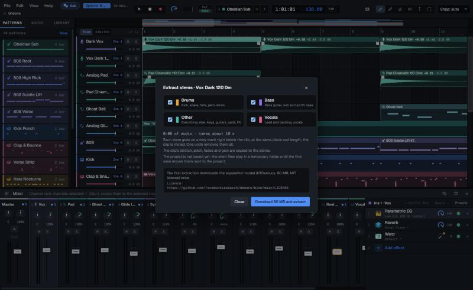

# Stems and chords

How to split a mixed song or sample into drums, bass, vocals and the rest, and how to turn the chords
of a recording into piano-roll notes. Both run on your computer, offline, after a one-time model
download.

## Quick start

1. Drop a song or sample onto a Playlist track.
2. Right-click the clip → **Extract stems…**, tick the stems you want and click **Extract**.
3. For chords: right-click the clip → **Detect tempo, key and chords…**, pick the bars and click
   **Send to piano roll**.

## Extract stems

Right-click an audio clip → **Extract stems…** (or **Stems…** in its sample editor). Tick any of:

| Stem | What it holds |
| --- | --- |
| **Drums** | Kick, snare, hats, percussion |
| **Bass** | Bass guitar, sub and synth bass |
| **Other** | Everything else: keys, guitars, pads, FX |
| **Vocals** | Lead and backing vocals |

Click **Extract N stems**. Each stem lands on a new track right below the clip, at the same place
and length, and the original clip is muted. One `Ctrl+Z` removes them all.

- The first extraction downloads the separation model (HTDemucs, about 90 MB, MIT licence) once.
  Until then the button reads **Download 90 MB and extract**.
- It runs in the background while the audio keeps playing. **Run in background** keeps the progress
  in a corner so you can keep working.
- The clip's stretch, pitch, fades and gain are copied to the stems, so together they play what the
  clip played. Pitch-editor edits are not carried over.
- The stems are 32-bit WAV files in the project's audio folder (a temporary folder until the first
  save).
- A clip longer than 30 minutes is refused: split it first.

Typical uses: take the vocal out of a song to practise or remix it, mute the drums of a loop and
program your own, or pull the bass line to study it.

## Detect tempo and key

Right-click an audio clip → **Detect tempo, key and chords…**. The dialog shows:

- **TEMPO (BPM)** with a confidence, and **Set tempo** to make it the project tempo. The clip is
  resized on the grid so it still plays the same audio.
- **KEY / SCALE**, and buttons to pass the key to Pitch Correct on a vocal channel.

The song key in the toolbar can also detect a key from all the audio in the project (it offers this
while it says *No key*).

## Turn chords into piano-roll notes

The same dialog has a **CHORDS** strip over the clip's bars.

1. Choose **Detailed** (7ths, maj7, m7, sus and diminished too) or **Simple** (major and minor only,
   the reliable outline, easier to play over). Chord names are spelled for the song's key and follow
   the clip's own transposition.
2. Drag on the strip to pick a range of bars, or click one chord. The Playlist's loop range is
   picked to start with.
3. Choose the channel to write for (or **New piano channel**) and click **Send to piano roll**.

The chords become a new pattern of block chords, placed on the Playlist under the clip: the root in
the bass, each chord in the inversion nearest the one before, so they voice-lead smoothly. Edit them
like any notes, or replace the piano with a pad.

The first use downloads the ChordMini model (17 MB, MIT licence). A clip with no clear harmony
(drums, a solo voice, noise) shows that no chords were detected.

## From the command line

`synkopa stems` and `synkopa chords --clip ID --to-pattern` do the same from a script or an agent.
See [Command line](../cli.md).

## Common problems

- **The download fails with a certificate error** on a work computer: see
  [Troubleshooting](troubleshooting.md#downloads-fail-certificate-errors).
- **"The clip's audio file is missing"**: relink the file first (the **Missing audio** dialog).

## See also

- [Arranging](arranging.md) for audio clips and stretching.
- [Making beats](making-beats.md#chords-scales-and-generators) for the chord tools in the piano roll.
- [Recording vocals](recording-vocals.md) for tuning an extracted vocal.
