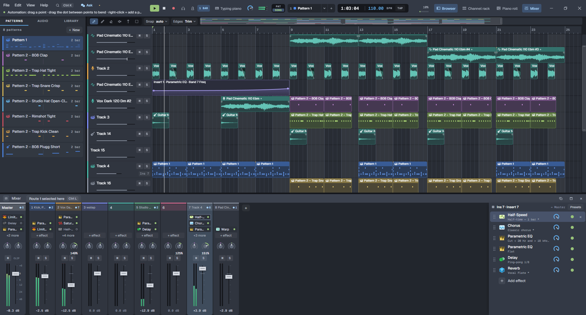

# The basics

How a Synkopa song is put together, and where each part of it lives on screen. Read this once and
every other page will make sense.



## The mental model

Synkopa works the FL Studio way. Sound is made by **channels**, written into **patterns**, arranged
as **clips** on the **Playlist**, and mixed on **mixer inserts** that all end in the **Master**.

```
 NOTES                         ARRANGEMENT                     SOUND
 ─────                         ───────────                     ─────
 Channel (instrument)          Playlist                        Mixer
   │  steps / notes              │                               │
   ▼                             │                               │
 Pattern ── placed as ──▶ Pattern clip on a track                │
                                                                 │
 Channel ─────────── plays through ──────────▶ Mixer insert ──▶ Master ──▶ your speakers / export
                                               (its effects)    (its effects)

 Audio file / recording ──▶ Audio clip on a track ──▶ Mixer insert ──▶ Master
```

- A **channel** is one instrument: a sampler playing a sound, the built-in synth, a sampled piano,
  a VST3 instrument. Channels belong to the whole project, not to one pattern, like FL's Channel
  Rack.
- A **pattern** is a short piece of music: the notes and steps for *any* of the channels. A drum
  loop, a bass line and a chord part can be one pattern or three. Every pattern can use every
  channel.
- A **clip** is a pattern (or an audio file, or an automation curve) placed on the Playlist. Ten
  clips of the same pattern all play that pattern: edit the pattern once and they all change.
- A **mixer insert** (a *mixer track* in FL) is a channel strip with a fader, pan and a chain of
  effects. Each channel plays into an insert; every insert goes to the **Master**, the final output.

One consequence surprises newcomers: a pattern has no fixed instrument and no fixed place in the
song. You decide where it plays by putting clips on the Playlist.

## The five windows

| Window | What it is for | Open it |
| --- | --- | --- |
| **Channel rack** | The channels, and the current pattern's steps for each of them | `F6`, the **Channel rack** button, **View → Channel rack**, double-click a pattern clip |
| **Piano roll** | Notes with pitch and length for one channel in the current pattern | `F7`, right-click a channel → **Piano roll** |
| **Playlist** | The song timeline: clips on tracks, markers, automation | Always there; `F5` brings it to the front |
| **Mixer** | Inserts, faders, effects, routing | `F9`, the **Mixer** button, **View → Mixer** |
| **Browser** | The project's patterns and audio, and the sample library | `Alt+F8`, the **Browser** button, **View → Browser** |

The Channel rack, the Piano roll and the Mixer can float as windows or be docked to the left,
right or bottom edge. Drag a window's title bar and drop it on one of the arrows to dock it.
**View → Window layout → Reset window layout** puts everything back to the first-launch layout.
`F5` hides floating windows behind the Playlist (and shows them again).

### The toolbar

The top row holds what you use all the time: the menus, **PAT / SONG**, play, stop and record, the
tempo and the song key, the **pattern selector**, the main volume with the output meter and CPU
meter, and the **Browser**, **Channel rack** and **Mixer** buttons. The row under it holds the status
line (what the last action did, or what the tool under the pointer does), the song position slider,
the position readout, the monitor, metronome, count-in and typing-piano switches, and **Follow**.

### PAT and SONG

Space plays one of two things, chosen with `L` or the **PAT / SONG** switch:

- **PAT** loops the current pattern only, through each channel's own insert. Use it while writing
  a beat.
- **SONG** plays the Playlist from the start position. A click on the Playlist's ruler or grid
  switches to SONG for you.

### The current pattern

There is always one *current pattern*: the one the Channel rack and the Piano roll show, PAT
plays, and the Draw tool places on the Playlist. Change it with the pattern selector in the toolbar
(click it for the list, or turn the mouse wheel over it), the number pad (`1`–`9`, `+`, `−`), by
clicking a pattern clip, or in the Browser's **PATTERNS** tab. `F4` jumps to the next empty
pattern (a new one), `F2` renames the current one.

## How a channel reaches the speakers

Each channel row in the Channel rack has a small box between its knobs and its name: the **mixer
insert** it plays into.

- **A number** means the channel always plays through that insert. The starter drums are on inserts
  1–4, named after them.
- **A dash** (*Like clip track*) means the channel plays through the insert of the Playlist track
  its pattern clip sits on. New synth and instrument channels start this way.
- **Double-click** the box to give the channel a free insert of its own, named and coloured after
  it. Click it to pick an insert from a list, or turn the wheel over it to step through inserts.

Audio clips work the same way: they play through their track's insert unless the sample is routed
to an insert of its own in its sample editor.

On the mixer, every insert goes to the Master. Inserts can also *send* to other inserts (a bus for
all drums, a shared reverb), and the Master's effects (a Limiter in a new project) process the whole
song. See [Mixing](mixing.md).

## Undo, saving and safety

- Every edit is one step in the undo history: `Ctrl+Z` undoes, `Ctrl+Shift+Z` or `Ctrl+Y` redoes.
  **Edit → Undo** names the step it will undo. Edits made from the `synkopa` command line are undo
  steps too.
- `Ctrl+S` saves, `Ctrl+Shift+S` saves under another name, `Ctrl+N` saves a new version beside the
  current file (`Beat_2`, `Beat_3`…) and carries on there.
- Each save keeps the previous file as `<name> (backup).synkopa`. An autosave (every 2 minutes by
  default, **Settings → General → Autosave**) keeps a recovery copy that Synkopa offers back if it
  closes unexpectedly. It never overwrites your project file.
- **File → Open recent** lists the last ten projects.

## Finding things

- `Ctrl+K` opens **Find a command**: type what you want to do (export, undo, mixer…) and every menu
  command is there with its shortcut.
- `?` opens the list of keyboard shortcuts. The full list is in [Shortcuts](shortcuts.md).
- The status line under the menus says what the tool under the pointer does.

## See also

- [Getting started](getting-started.md): a guided first beat.
- [Making beats](making-beats.md), [Arranging](arranging.md), [Mixing](mixing.md).
- [Instruments](../instruments/README.md) and [Effects](../effects/README.md).
