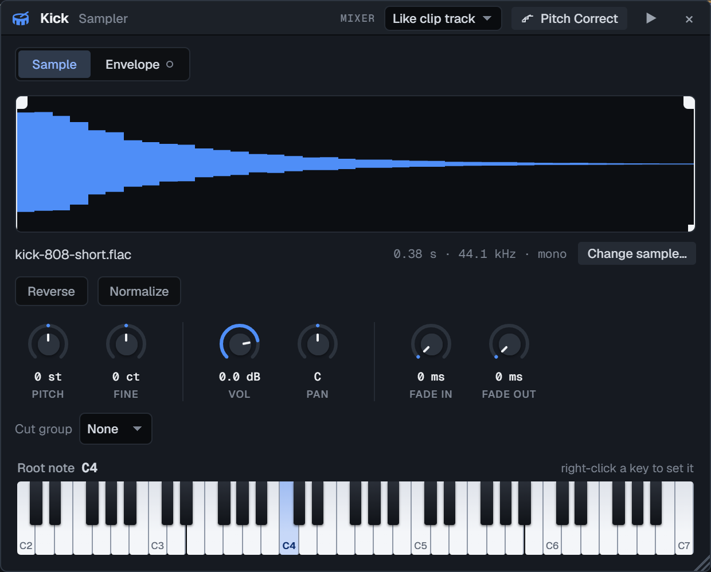
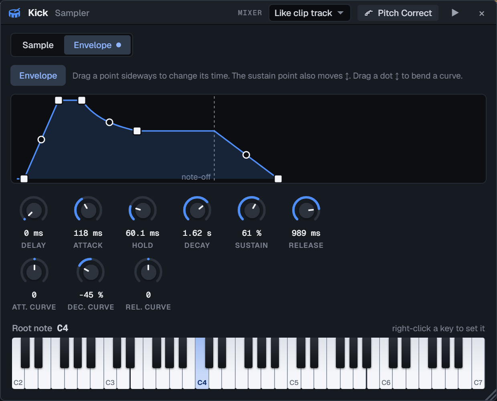

# Sampler

The sampler plays one audio file from a Channel Rack channel: a drum hit on the step sequencer, a
one-shot played up and down the keyboard, or a loop chopped into slices you can rearrange.



## Quick start

1. In the Channel Rack, click **+ Channel**. Under **Sampler**, open a group (Kicks, Snares, Hats,
   Loops...) and click a sample. Or pick **File from disk…** for your own file.
2. Click steps in the channel's row to program a beat.
3. Click the channel's name to open the sampler window.
4. Click the waveform to hear the sample. Drag the white start and end markers to play only part of it.
5. Turn **PITCH** to tune it, **VOL** and **PAN** to place it.

You can also add samples from the Browser's **LIBRARY** tab: select a file and press `Enter`, or drag
it onto the Channel Rack. Every sample you add this way becomes a sampler channel.

## Where the sounds come from

- **The standard library** ships inside Synkopa: more than 200 one-shots in groups (Kicks, Snares,
  Claps, Hats, Cymbals, Toms, Percussion, 808, Tonal, Orchestra, FX) and 11 melodic loops (**Loops**).
  It is always there, in every project, on every computer.
- **Downloadable kits.** In the Browser's **LIBRARY** tab, click **+** (**More sounds to download**) at
  the bottom of the list, then **Install** on a kit. It downloads once and appears in the list like
  the standard library.

  | Kit | What it is | Size |
  | --- | --- | --- |
  | 808 Kit | 30 Roland TR-808 one-shots | 2 MB |
  | 808 Bass | Long-decay 808 kick played chromatically, C1–B3, two tail lengths | 2 MB |
  | Percussion & FX | Hand percussion, velocity layers where recorded | 15 MB |
  | Studio Drums | Acoustic kit, up to four velocity layers per pad | 23 MB |
  | Marimba | Five octaves, three dynamics | 22 MB |
  | Glockenspiel | Two and a half octaves, three dynamics | 9 MB |

- **Your own files:** **File from disk…** in the **+ Channel** menu, or add a folder of samples under
  **FOLDERS** in the Browser's **LIBRARY** tab.
- **Audio already in the project** (a recorded vocal, an imported loop): **+ Channel → Project audio**.

To swap the sound of an existing channel and keep its notes and routing, right-click the channel →
**Replace**, or click **Change sample…** in its window.

## Play a sample across the keyboard

The **Root note** is the key at which the sample plays at its own pitch. Other keys pitch it up or
down. Samples from the **Tonal** group and other pitched library sounds set the root note for you, so
they play in tune. For your own file, right-click the key that matches its pitch on the window's
keyboard.

Use **PITCH** (±24 semitones) and **FINE** (±100 cents) to retune the whole channel on top of the notes.

## Cut a long sound short

- **A closed hat that stops the open hat:** put both channels in the same **Cut group** (1–8). A new
  note in the group silences what the group is playing. A channel in a group also cuts itself, which
  stops long 808s from overlapping.
- **Trim the sample:** drag the start and end markers on the waveform. Double-click a marker to go
  back to the whole file.
- **Smooth the edges:** **FADE IN** and **FADE OUT** fade the sample itself at the start and end of
  the trimmed part, in milliseconds of the original file. Drag the knobs or the fade handles on the
  waveform.

## Shape every note with the envelope

The **Envelope** page is a volume envelope, like FL Studio's Channel settings ▸ Volume. It is off by
default: the sample plays as recorded.



1. Open the **Envelope** page and click **Envelope** to switch it on. A lit dot on the tab shows it is on.
2. Drag the points on the graph sideways to change **Delay**, **Attack**, **Hold**, **Decay** and
   **Release**. The decay point also moves up and down for **Sustain**.
3. Drag a round dot up or down to bend a curve (**Att. curve**, **Dec. curve**, **Rel. curve**).
   Double-click a point or dot to reset it.

While the envelope is off, the graph is dimmed and its knobs only prepare a shape: nothing changes in
the sound until you switch it on.

**Fades or envelope?** A fade shapes the sample itself and is heard the same on every note. The
envelope shapes each note from when it starts and from when it is released, so a short note and a long
note sound different.

## Chop a loop into slices

Slice mode cuts a sample into pieces and puts each piece on its own key, like FL Studio's Slicex or an
MPC chop. Use it to rearrange a drum break, play a vocal phrase word by word, or replay a loop in a new
order.

1. Add a loop (for example from **+ Channel → Sampler → Loops**) and open its window.
2. Open the **Slice** page.
3. Click **Transients** to cut at every hit, then turn **Sensitivity**: higher finds quieter hits too,
   lower keeps only the strongest. Or click **Equal** and choose 4, 8, 16 or 32 equal slices.
4. Click a slice to hear it. Drag a marker to move it. Double-click empty space to add a marker, or a
   marker to remove it.
5. Click **Dump to pattern**. One note per slice is written into the current pattern, in the original
   timing, and the Piano roll opens. The pattern now plays the loop back as it was.
6. Move, delete or repeat the notes in the Piano roll to rechop the loop.

How slices play:

- The root note plays slice 1, the next key slice 2, and so on. The bar above the waveform shows the
  count and the key range, for example "8 slices · C4–G4". Keys outside that range play nothing.
- Each slice plays from its marker to the next at the sample's own pitch. **PITCH** and **FINE** still
  transpose all of them.
- A channel plays one slice at a time: a new slice cuts the one sounding, as on an MPC.
- The envelope, Reverse, fades and the cut group apply to every slice.
- **Clear** removes the slices; the sampler plays the whole sample by pitch again.

Tips:

- **Dump to pattern** replaces this channel's notes in the current pattern; other channels' notes stay.
  Undo (`Ctrl+Z`) brings them back.
- The notes are placed in real time at the project tempo. If the loop's tempo (often in its name)
  differs from the project's, set the project tempo to it first, or quantize the notes afterwards.
- A slice is at least 30 ms long, and a channel holds at most 128 slices.

## Controls

**Sample page**

| Control | What it does | Try |
| --- | --- | --- |
| Waveform | Click to hear; drag the start/end markers to trim; drag the fade handles | Trim a long crash |
| **Change sample…** | Pick another file for this channel; notes and routing stay | |
| **Reverse** | Plays the trimmed part backwards | Reversed cymbal into a drop |
| **Normalize** | Raises the file's peak to −0.3 dB | Quiet recordings |
| **PITCH**, **FINE** | Transpose in semitones (±24) and cents (±100), on top of the notes | −12 for a darker snare |
| **VOL**, **PAN** | The channel's level and pan | |
| **FADE IN**, **FADE OUT** | Fade the sample's edges (0–5000 ms of the file) | 5 ms fade in to remove a click |
| **Cut group** | Channels in a group silence each other (None, 1–8) | Open and closed hats in group 1 |
| **Mixer** | The mixer insert the channel plays through; **Like clip track** follows the Playlist track | |
| **Root note** | Right-click a key on the keyboard to set the key that plays the sample at its own pitch | |

**Envelope page**

| Control | What it does | Try |
| --- | --- | --- |
| **Envelope** | Switches the volume envelope on or off | |
| **Delay** | Silence before the attack (0–5 s) | |
| **Attack** | Time to rise to full level (0–2 s) | 50 ms to soften a pad sample |
| **Hold** | Time at full level before the decay (0–5 s) | |
| **Decay** | Time to fall to the sustain level (0–5 s) | |
| **Sustain** | Level held until the note ends; 0 % makes the decay the whole sound | 0 % with a short decay for a tight 808 |
| **Release** | Fade to silence after the note ends (1 ms – 5 s, default 20 ms) | 300 ms for a vocal chop tail |
| **Att. curve**, **Dec. curve**, **Rel. curve** | Bend each segment: up bows it up, 0 is straight | Negative decay curve for punch |

**Slice page**

| Control | What it does | Try |
| --- | --- | --- |
| **Transients** / **Equal** | Cut at every hit, or into equal parts | Transients on drum breaks |
| **Sensitivity** | How quiet a hit can be and still get a slice (Transients) | Lower it when ghost notes over-slice |
| **4 / 8 / 16 / 32** | Number of equal slices (Equal) | 16 for a one-bar loop |
| **Clear** | Remove all slices | |
| **Dump to pattern** | Write one note per slice into the current pattern | |

## Common problems

- **The envelope's release is not heard on step-sequencer notes.** A Channel Rack step has no end: it
  plays the sample through, holding the sustain. Draw held notes in the Piano roll, or set **Sustain**
  to 0 % so the decay ends the sound.
- **The envelope does nothing.** Its switch is off. Click **Envelope** on the Envelope page.
- **Some keys are silent.** Slice mode is on and those keys are outside the slices. Click **Clear** on
  the Slice page to play the whole sample again.
- **Transients misses hits or adds too many.** Turn **Sensitivity**, then move or double-click markers
  by hand.

## Technical notes

For scripting, automation and contributors.

**Project format.** A sampler channel is `kind: "sample"`, playing project source `source`. `root` is
the key at which the file plays at its own pitch (default 60, C4 in Synkopa's labels, C5 in FL's
naming). `sampler` holds `start`/`end` (fractions 0..1), `reverse`, `norm`, `semi` (−24..24), `fine`
(−100..100), `env`, `delay`, `attack`, `hold`, `decay`, `sustain` (0..1), `release`, `attackTension`,
`decayTension`, `releaseTension` (−1..1), `cut` (0 = none, 1..8), `fadeInMs`, `fadeOutMs` (0–5000 source
ms). Every field has a default, so older files load. `putChannel` refuses out-of-range values
(`SamplerState::check`). `slices` (optional): increasing fractions of the file where each slice starts,
at most 128, the first normally 0; absent or empty = off. Full field semantics: the "Channels, patterns
and notes" and "Sampler slice mode" sections of [the architecture notes](../dev/architecture.md).

**Envelope.** Off, the sample plays as recorded: live keys, auditions and legacy notes ring to its end,
sized notes stop at theirs (declicked). On, a note-off (key released, end of a held note or legacy
note, end of an audition) starts the release from whatever level the envelope had. A step trigger
(`trig: true`) has no note-off and holds the sustain. Tension bends progress as `x/(x + g(1−x))` with
`g = 8^∓tension`, so ±1 reaches 8/9 or 1/9 half way. The voice computes its level from its own time and
note-off time, so it needs no per-voice state beyond the cut level. Fades are independent of the
envelope (source time vs note time), bounded by the region, multiply where they overlap, swap sides
with Reverse; the automatic 1.5 ms declick at trimmed or reversed edges still applies. Files written
before `env` existed open a gated or shaped sampler (attack > 0 or sustain < 1) with the envelope on.

**Slices.** Key `root + i` plays slice `i` from its marker to the next one (the last to the end of the
file) at the file's pitch plus `semi`/`fine`; other keys play nothing; a new slice note cuts the
channel's sounding slice with the 5 ms cut-group fade. The engine suggests slice points with
`source_onsets` (`crates/engine/src/slices.rs`: SuperFlux, log-filtered spectral flux with a maximum
filter, 2048-point Hann, 5 ms hop, 24 bands per octave; local peaks above the local mean, each moved
back to where its attack starts). Detection runs once per file; the UI keeps the candidates above the
Sensitivity threshold (`ui/src/lib/slicer.ts`), so the knob never re-analyses. The in-browser mock
detects from the peak envelope instead. "Dump to pattern" writes held notes (`trig: false`), one per
slice, at its time in the file at the project tempo. Tests: `crates/engine/tests/sampler.rs`
(`slice_mode_*`), `ui/src/lib/slicer.test.ts`.

**Library.** The standard library is embedded in the engine (`crates/engine/src/factory.rs`,
`crates/engine/library`: FLAC one-shots, Ogg Vorbis loops) and stored in projects by a portable path,
`lib:Standard/<file>`, so it is never missing. Downloadable kits are listed in `assets-manifest.json`
(each file with its SHA-256) and installed under the sample library folder; sources inside them are
stored as `lib:<kit>/<file>`. Credits: `THIRD_PARTY_NOTICES.md`.

**CLI.**

```sh
synkopa channels --add snare-studio                         # a sampler of a standard-library sample
synkopa channels --sample 1001                              # a sampler of project source 1001
synkopa channels --ch "Studio Snare" --param cut --value 1  # any field of `sampler` above
synkopa channels --ch "Studio Snare" --param fadeOutMs --value 80
```

Slices have no dedicated CLI flag; set them with a `putChannel` op through `synkopa apply`.

## See also

- [Making beats](../guide/making-beats.md): the Channel Rack, step sequencer and Piano roll
- [Choosing an instrument](README.md)
- [Synthesizer](synth.md): 808 and bass presets with glide
- [CLI](../cli.md)
