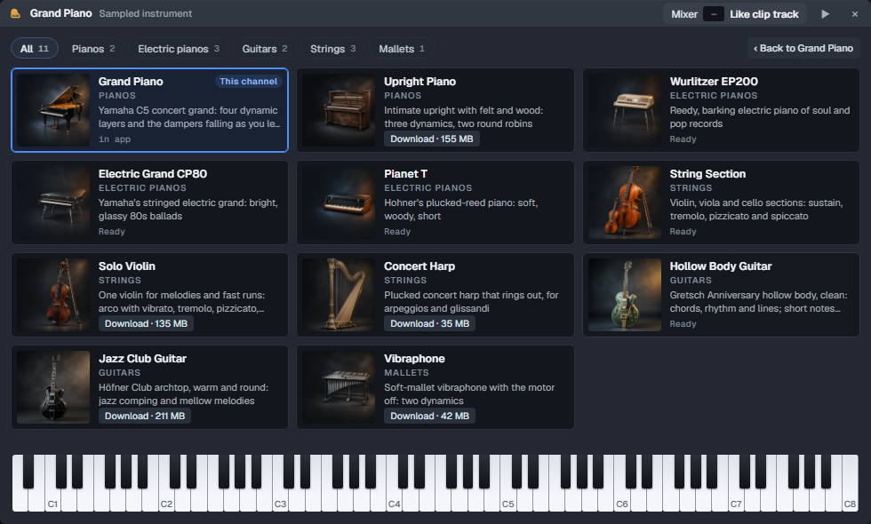

# Synkopa Instruments

Synkopa Instruments plays real recorded instruments (pianos, electric pianos, strings, guitars, harp,
vibraphone) from one Channel Rack channel, for parts that should sound played rather than synthesized.



## Quick start

1. In the Channel Rack, click **+ Channel**, then **Synkopa Instruments — pianos, strings, guitars**.
   A channel named "Grand Piano" appears. Click its name to open its window.
2. Play it from a MIDI keyboard (the sustain pedal works), the on-screen keyboard at the bottom of the
   window, or draw notes in the Piano roll (`F7`).
3. Click **Instruments** to see every instrument as a card. Click a card: the channel plays it at once,
   and the library stays open so you can try the next one.
4. An instrument you do not have yet shows **Download** with its size. Click it once; it is saved into
   the sample library for every project.
5. Double-click the card, press `Esc` or click **Back** to return to the instrument's face and its knobs.

## The instruments

Only the Grand Piano ships inside the app. The others download once, on demand.

| Instrument | What it is | Download |
| --- | --- | --- |
| Grand Piano | Yamaha C5 concert grand: 4 dynamics, key-release noises | in app |
| Upright Piano | Felt-and-wood upright: 3 dynamics, 2 round robins | 155 MB |
| Wurlitzer EP200 | Reedy electric piano | 21 MB (one kit with the next two) |
| Electric Grand CP80 | Yamaha's stringed electric grand | same kit |
| Pianet T | Plucked-reed piano: soft, woody, short | same kit |
| String Section | Violins, violas and cellos: sustain, tremolo, pizzicato, spiccato | 198 MB |
| Solo Violin | One violin: arco with vibrato, tremolo, pizzicato, spiccato | 135 MB |
| Concert Harp | Rings out on its own; for arpeggios and glissandi | 35 MB |
| Hollow Body Guitar | Gretsch Anniversary, clean: chords, rhythm and lines | 306 MB |
| Jazz Club Guitar | Höfner Club archtop, warm and round | 211 MB |
| Vibraphone | Soft mallets, motor off, 2 dynamics | 42 MB |

The library filters them by **All**, **Pianos**, **Electric pianos**, **Guitars**, **Strings** and
**Mallets**. Each card says whether the instrument is **in app**, **Ready** (downloaded), or offers a
download.

## Switch instruments while you play

On the instrument's face, **‹** and **›** step to the previous or next instrument (like FL's preset
arrows). In the library, the arrow keys move between cards and `Enter` picks one; `Enter` on the card
the channel already plays goes back to its face.

Changing the instrument is one undo step. A channel still named after its instrument takes the new name.
The **Release** and the articulation belong to the old instrument and reset; the other knobs stay.

## Play strings with the right articulation

The strings and the solo violin show their articulations as buttons above the knobs. They start on
**Auto**, as modern string libraries do: a short note (under 0.13 s) plays spiccato, a longer one
sustain. A note played live, whose length is unknown when it starts, plays sustain.

You can also switch while playing with keyswitches: the keys C1–D♯1, tinted on the keyboard. A note on
a keyswitch picks that articulation instead of sounding. The choice is saved with the channel.

## Make the guitars sound like a guitar

The guitars place each note on one of six strings in standard tuning, so a chord spreads across the
strings the way a guitarist would voice it. A new note on a string damps the one already ringing there,
so repeated strums do not pile up.

- **Sustain** (keyswitch C2) and **Staccato** (C♯2). On **Auto**, a note shorter than 0.15 s plays
  staccato.
- For a natural strum, spread a chord's notes by a few milliseconds per string with the Piano roll's
  strum tool, lighter on the upstrokes.

## Controls

| Control | What it does | Try |
| --- | --- | --- |
| **Tone** | Darker or brighter: a ±9 dB shelf over the highs above about 1.8 kHz | −30 to sit a piano behind a vocal |
| **Width** | Stereo width: 0 % mono, 100 % as recorded, up to 150 %. Dimmed on instruments recorded in mono (electric pianos, guitars) | 60 % for a piano in a busy mix |
| **Tune** | Fine tune ±100 cents | Match a sample that is slightly off |
| **Attack** | Fades every note in (0–2 s). It can only slow the instrument's own attack | 300 ms on strings for swells |
| **Release** | How long a note rings after the key is let go (40 ms – 3 s). **Auto** uses each recording's own time | Short release for tight piano stabs |
| **Dynamics** | How much velocity changes the level (the tone always follows velocity) | 60 % for an even, compressed feel |
| **Noise** | Level of key-release noises (piano dampers, fingers leaving strings). Dimmed on instruments without them | 0 % for a clean pad-like piano |
| **Volume**, **Pan** | The channel's own level and pan | |
| **Articulation** | The instrument's playing styles, when it has several | **Auto** for strings |

Double-click a knob to reset it (for **Release**, back to **Auto**). Right-click a knob to automate it.
**Tone**, **Width**, **Tune** and **Noise** glide over about 10 ms when turned or automated; **Attack**
applies to notes that start after it changes.

## Common problems

- **The channel is silent.** The instrument is not downloaded yet: the face says **Not downloaded** and
  offers **Download**. Until then the channel plays nothing.
- **A note does not sound on a string instrument.** It may be a keyswitch (tinted keys C1–D♯1): those
  switch the articulation instead of playing.
- **Keys outside the range are dimmed.** They still play, pitched from the nearest recording.
- **Export waits.** Export waits until every instrument the project plays is loaded, and refuses to start
  when one is missing, rather than rendering silence.

## Credits

A CC-BY instrument shows its credit under the knobs. A song that uses it should credit the recordings.

| Instrument | Recordings | Licence |
| --- | --- | --- |
| Grand Piano | [Salamander Grand Piano V3](https://github.com/sfzinstruments/SalamanderGrandPiano), Alexander Holm | CC-BY-3.0 |
| Upright Piano | [VSCO 2 CE](https://github.com/sgossner/VSCO-2-CE) Upright Nr1, Versilian Studios | CC0 |
| Wurlitzer EP200, Electric Grand CP80, Pianet T | [E-Pianos](https://github.com/sfzinstruments/GregSullivan.E-Pianos), Greg Sullivan | CC-BY-3.0 |
| String Section, Solo Violin, Concert Harp | VSCO 2 CE, Versilian Studios | CC0 |
| Hollow Body Guitar, Jazz Club Guitar | [Black And Green Guitars](https://github.com/sfzinstruments/karoryfer.black-and-green-guitars), Karoryfer Samples (Brian Wood) | CC0 |
| Vibraphone | [VCSL](https://github.com/sgossner/VCSL), Versilian Studios | CC0 |

## Technical notes

For scripting, automation and contributors.

### Ids, project format and CLI

Instrument ids: `grand-piano`, `upright-piano`, `wurlitzer`, `cp80`, `pianet`, `strings`, `solo-violin`,
`harp`, `hollow-body-guitar`, `jazz-guitar`, `vibraphone`. Hollow Body and Jazz Club guitars: every
semitone E2–D6, 3 dynamics × up to 4 round robins, staccato, hand-damping noises.

Project format: `{"kind": "keys", "keys": {"instrument": "strings", "dynamics": 100, "articulation": 26, "attack": 0, "tone": 0, "width": 100, "tune": 0, "noise": 100}}`
(projects without the last five play them at their defaults). `instrument` defaults to `grand-piano`,
`release` (ms) is absent for Auto, `articulation` absent for the instrument's first one. Projects made
before there was a choice (`{"release": 350, "dynamics": 100}`) play the grand piano with their saved
release, as they did.

Knob ids and ranges: `tone` −100 … +100 (default 0), `width` 0–150 % (100), `tune` ±100 cents, `attack`
0–2000 ms (0), `release` Auto or 40–3000 ms (−60 dB at the end; Auto = each region's own time as mapped:
the piano's dampers 0.5 s, its top two octaves without dampers 3–4 s, the strings 1.4 s), `dynamics`
0–100 % (100), `noise` 0–100 % (100). Automation target: `{kind: "keys", chanId, param}` (release log
40–3000 ms, attack 0 at the bottom then log 1–2000 ms, the rest linear).

```sh
synkopa channels --keys --instrument wurlitzer
synkopa channels --ch "String Section" --articulation pizzicato
synkopa channels --ch "Grand Piano" --param release --value 600    # 0 = Auto
synkopa channels --ch "Grand Piano" --param tone --value -30        # attack, tone, width, tune, noise too
synkopa catalog                                                       # "keys": the instruments and their articulations
```

Library kits are checked against the SHA-256 pinned in `assets-manifest.json` when downloaded.

### How it works

Every instrument is an SFZ mapping embedded in the program (`crates/engine/instruments/*.sfz`) over the
files of its kit. `crates/engine/src/sfz.rs` parses the part of SFZ the player supports:
`<control>/<global>/<master>/<group>/<region>/<curve>`, `#define` and `#include`; key and velocity
ranges, `pitch_keycenter`/`pitch_keytrack`, `tune`/`transpose`, `volume`/`amplitude`/`pan` (and
`global_/master_/group_volume`), `amp_veltrack` and `amp_velcurve_N`, velocity and key crossfades,
`trigger=release` with `rt_decay`, round robins (`seq_length`/`seq_position`, `lorand`/`hirand`), the
amplitude envelope (`ampeg_*`), `offset`/`end`, loops, `group`/`off_by`, keyswitches with `sw_label`, and
`*_onccN` modulation of those. CCs are not routed into a playing instrument (except the sustain pedal): a
CC modulation is evaluated at load from the CC's default (`set_cc`/`set_hdcc`), the extended CCs 131
(velocity) and 133 (key) per note. Unknown opcodes are counted, not fatal; every catalog instrument
parses with none.

`crates/engine/src/keys.rs` loads the recordings an instrument names (decoded on a few threads, cut at
9 s with a 1.5 s fade unless a region loops them) and keeps them as 16-bit PCM — half of `f32`, far
below the recordings' own noise. A note plays every region its key, velocity, round robin and keyswitch
select, resampled with cubic interpolation, under its ADSR; a sequenced note schedules its key-release
regions at its end, a live note plays them at its note-off (or when the pedal lets it go). Voices come
from the engine's shared pool of 128, oldest stolen first. The bank is an `Arc` built off the audio
thread; a voice only reads it. No allocation, lock or I/O in the callback.

The guitars' string model: each note goes to the highest of six strings (E2 A2 D3 G3 B3 E4) that
reaches it, so an open C, a G or an F barre each land one note per string; a note whose string is still
held moves one string down. A new note on a string damps the one it was ringing over 30 ms. The mappings
level each note against its neighbours (the recordings vary from note to note) and the staccato against
the sustain; `scripts/keys-kits.mjs` measures the files when it writes them.

The app loads an instrument the first time a channel plays it and drops it when none does, so browsing
does not pile them up in memory (about 190 MB for the piano, 140 MB the strings, under 40 MB the others).
An offline bounce (`synkopa render`, Export) waits for every instrument the project plays and refuses to
start silently when one is missing.

Levels: the same four-bar phrase rendered on every instrument sits at −28 ± 1.5 dBFS RMS
(`cargo run --release -p wave-engine --example keys_demo -- target/keys-kits target/keys-demo`).
Recordings play 12 dB lower than a single loud note would need, so chords have headroom (the same
chord headroom as the [synthesizer](synth.md#tips)).

### The grand piano's mapping

4 of the Salamander's 16 dynamics (layers 1, 6, 11, 16) at every minor third from A0 to C8, plus its 88
key-release recordings 40 dB down. Inside its velocity band a layer is levelled by (velocity / the
velocity it was played at)^k, with k measured from the level step to the next layer (RMS of the first
0.5 s, mean over the 30 notes: 1.0, 0.95, 1.83), so the level is continuous across a layer boundary and
only the timbre changes.

The installer carries the recordings prepared, not as downloaded (33 MB instead of 185 MB):
`node scripts/fetch-keys.mjs` downloads the originals into `target/keys-src` (checksummed, reused on the
next run) and runs `wave-keys-prep` (`crates/keys-prep`), which applies the 9 s cut ahead of time and
stores 16-bit FLAC with triangular dither into `app/resources/keys` (not in Git); `tauri build` ships that
folder, and the release workflow runs the script. The tool decodes every file it writes and stops the
build if any sample is more than 1.6 steps of 16-bit from the cut original (the largest difference on
the current files is −86.8 dBFS). A build without the folder (a plain `cargo build`) offers the download
instead.

### Adding an instrument

`node scripts/keys-kits.mjs [kit ...]` builds the downloadable kits: for each it downloads the recordings
it plays (pinned to a commit, cached in `target/keys-kits`), writes their SHA-256 and size into
`assets-manifest.json`, and writes the instrument's SFZ mapping. Add the instrument to `CATALOG` in
`keys.rs`, level it with `keys_demo`, and run
`WAVE_WRITE_FIXTURES=1 cargo test -p wave-engine --test keys_catalog_fixture` so the browser mock lists
it. Only recordings whose licence allows redistribution qualify (CC0, CC-BY, public domain).

### Not supported yet

Streaming from disk (every recording is in memory while an instrument plays), importing your own `.sfz`
files, filters and LFOs from SFZ, legato transitions, and loops for the strings: a sustained string note
lasts as long as its recording (a few seconds, at most 9 s), not as long as the note. Range and
directional keyswitches (`sw_lolast`, `sw_up`, ...) are counted as ignored opcodes, not played.

## See also

- [Choosing an instrument](README.md)
- [Synthesizer](synth.md)
- [Music Box](music-box.md)
- [CLI](../cli.md)
