# Synkopa UX simplification audit

*Audited build: `main` at `5e238fed`, November 2026. Prototypes: branch `ux/simplification-prototypes`, based on the same commit, not merged and not rebased onto later `main`.*

## 1. Executive summary

Synkopa's core loops are already short. Recording a take is three key presses, a kick-to-bass
sidechain is three actions and sets up the compressor for you, automating any control is two
clicks, and the effect picker is search-first. The audit did not find a surface that needs a
redesign.

What it did find is friction at the seams between surfaces, most of it cheap to remove:

1. **Picking a pattern to paint pops the Channel Rack open over the playlist.** Arranging four
   patterns took 12 actions instead of 8, and each pick covered four of the six visible lanes.
2. **The status line truncates the message it exists to show.** After a right-click deleted a
   recorded take, the explanation was cut to "C…" (15 px of the 308 px it needed) while a
   permanent tool hint kept its space.
3. **The synth window is 1026 px tall on a 768 px screen.** A third of it, including the
   envelopes, cannot be reached.
4. **The same pattern dropdown is on screen up to three times**, and the same routing job has
   two pickers with different abilities.
5. **Defaults stop one step short.** Split patterns are named "Pattern 1 – Kick", new
   instruments are left without a mixer strip while the starter kit gets one each, and track
   routing cannot ask for "a free insert" the way channel routing can.

Twelve of the proposals are implemented as working prototypes (one commit each) and shown
below as real before/after screenshots. Three structural proposals are shown as mockups and
are labelled as such. Nothing was changed on `main`.

**Recommended first batch** (all small, low risk): findings 1, 2, 3, 4, 5 and 8.

## 2. Method and limits

**What was run.** The real UI from `main`, in Chromium, driven with Playwright through a
scripted journey: new project → program a beat in the Channel Rack → add a synth bass → write
a bass line in the Piano roll → split the pattern by channel → arrange eight bars → record a
take → edit its pitch → route the take and the bass to mixer inserts → add a compressor →
sidechain kick to bass → automate the bass fader → open the export dialog → save. The same
script was then run against the prototype branch, so every before/after pair below shows the
same step of the same journey. Sizes: 1366×768 (primary) and 1920×1080; themes: Graphite
(dark) and Light. Baseline frames:
[1366 dark](ux-audit/before-default-1366.jpg) ·
[1366 light](ux-audit/before-default-1366-light.jpg) ·
[1920 dark](ux-audit/before-default-1920-dark.jpg) ·
[1920 light](ux-audit/before-default-1920-light.jpg). No finding was specific to the light theme.

**What was read.** Every view in `ui/src/views`, the shell (`App.tsx`), the shortcut table and
all context menus were inventoried with file and line references (section 6).

**Limits. Read these before trusting a number.**

- The journey ran against the in-browser `MockBackend` (`ui/src/api/mock.ts`), which the
  repository requires to behave like the engine. The native Tauri window, real audio devices,
  real recording latency and real export rendering were **not** exercised. Recording,
  pitch analysis and export results in the screenshots are the mock's.
- No user testing was done and no usage telemetry exists. Nothing below claims that a feature
  is rarely used. Where a proposal depends on how often something is used, it is marked
  **hypothesis**.
- Interaction costs are counted actions (a click, a key press, a drag, a typed name each count
  as one). Times are Keystroke-Level Model estimates (pointing 1.1 s, click 0.2 s, key 0.28 s,
  hand moving between mouse and keyboard 0.4 s), not stopwatch measurements.
- FL Studio was compared through its manual and forum threads, not by driving the application.

## 3. What already works and should not be touched

These were measured in the same journey and are faster than the usual FL Studio flow. They are
listed so that later simplification work does not break them.

| Task | Cost today | Why it works |
|---|---|---|
| Record a take | `R`, `Space`, `Space` | Destination is inferred (armed track, else first free track) and shown in the toolbar while armed; a toast offers Delete. |
| Sidechain kick → bass | right-click strip → *Sidechain to* → *Warm Bass* (3) | Keys an existing compressor or adds one already set to duck, and opens it. FL needs the routing step plus a setting inside the plugin. |
| Automate a control | right-click → *Automate on the playlist* (2) | Clip lands on a free lane at the loop or start marker and is selected. |
| Add an effect | *Add effect*, type, `Enter` (3) | Search-first picker with categories, favourites and presets. |
| Route a channel to its own strip | double-click the rack's insert box (2) | Takes the first unused insert and names and colours it after the channel. |
| Tune a take | right-click name → *Edit pitch…* → *Correct all* (3, with the default style) | Analysis starts on open. |
| PAT → SONG | automatic when the first clip is placed | The transport follows what you are doing. |

The sidechain result after three actions (compressor added, keyed to the kick, window open):

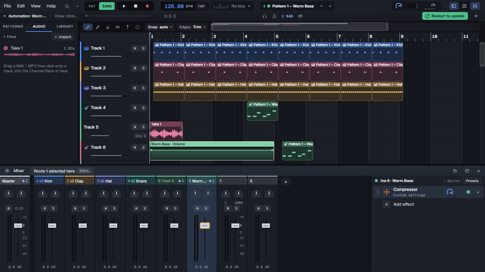

## 4. Findings

Ranked by user impact × how often the step occurs × confidence, against effort and regression
risk. "Prototype" means a working change on `ux/simplification-prototypes`; "mockup" means an
edited screenshot of the real UI.

### 1. Picking a pattern as the brush opens the Channel Rack over the playlist

**Observed.** In the Browser's PATTERNS tab a single click both selects the pattern as the
playlist brush and opens it in the Channel Rack (`ui/src/views/Browser.tsx:187`,
`pick(…, () => openPattern(p.id))`). The rack floats by default, so at 1366×768 it covers
lanes 1–4 of the six visible lanes, which is where the next paint stroke goes. During the
journey the first paint attempt landed on the rack instead of the playlist.

**Why it matters.** Arranging is "pick, paint, pick, paint". Selecting a tool should not
change the layout under the pointer (stable layout; interaction cost). The playlist itself
already uses double-click to open a clip's pattern, so single-click-opens is also inconsistent
inside Synkopa. (FL Studio's Picker, as far as I know it, selects on click without opening the
Channel Rack; this was not re-checked in the application.)

**Proposal: Contextualize.** Click = select as brush. Double-click = open in the rack.
Dragging a row to the playlist is unchanged.

| Before: one click on "Pattern 1 – Kick" | After (prototype): same click |
|---|---|
| 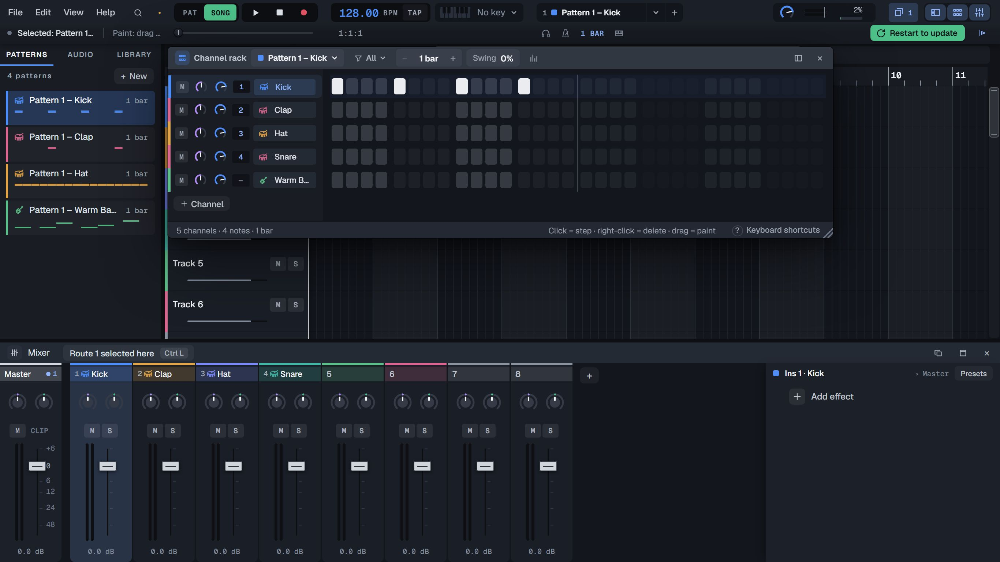 | 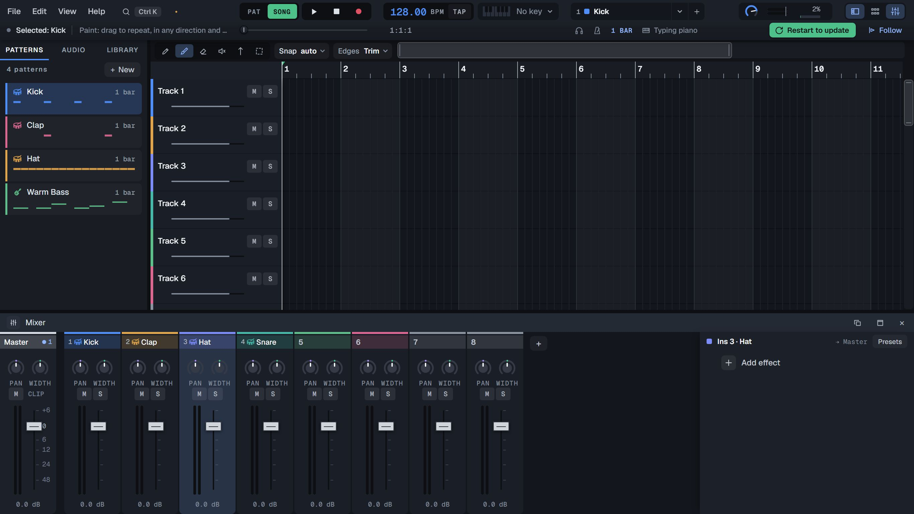 |

| Measure (place 4 patterns over 8 bars) | Before | After |
|---|---|---|
| Actions | 12 (4 picks, 4 × `Esc`, 4 paints) | 8 (4 picks, 4 paints) |
| Times the playlist is covered | 4 | 0 |
| KLM estimate | ≈ 19 s | ≈ 15 s |

**Trade-off.** Users who relied on click-to-open need a double-click; `F6` and the toolbar
pattern button still open the rack with one action. Risk: low.

### 2. The status line truncates messages and keeps a permanent hint instead

**Observed.** A right-click on the body of the recorded take deleted it (FL behaviour: body =
delete, name bar = menu). The one explanation, "Clip: right-click the name = menu ·
right-click below = delete", was rendered as "C…": the readout is capped at half of the status
area (`ui/src/styles.css:761`) and the record-destination chip and the tool hint take the
rest. Measured: 15 px visible of 308 px needed. Separately, the tool hint itself is cut at
290 px of 386 px at every window width, including 1920 px, where there is free space beside
it.

**Why it matters.** This is the application's only channel for "what just happened". A
destructive action whose feedback is unreadable breaks error recovery (NN/g: visibility of
system status; undo must be discoverable). The hint that wins the space is static text an
experienced user no longer reads.

**Proposal: Relocate priority.** The message wins; the hint shrinks first and may collapse,
then the record-destination chip, then the input meter narrows. On wide windows the status
column takes the room it needs.

| Before | After (prototype) |
|---|---|
|  |  |

Full frame of the same moment: [before](ux-audit/before-rclick-delete.jpg) ·
[after](ux-audit/after-rclick-delete.jpg).

The tool hint at 1920 px:

| Before | After (prototype) |
|---|---|
|  |  |

**Not changed.** Right-click-deletes stays; it is the FL convention the product follows.
Recommended follow-up (not prototyped): when the deleted clip is a recording, reuse the
existing "Recorded … · Delete" toast as "Deleted Take 1 · Undo", so the recovery is one click
and does not depend on the status line.

| Measure | Before | After |
|---|---|---|
| Message visible at 1366 px, record armed | 15 px of 308 | 234 px of 308 (full text on hover) |
| Tool hint at 1920 px | cut at 290 px of 386 | shown in full |

**Trade-off.** The tool hint disappears while a message is shown. This reverses a decision the
code base had made on purpose: an existing end-to-end test (`ui/e2e/updateStatus.spec.ts`)
asserted that a long message leaves the hint half the line, and the prototype changes that
expectation. At 1366 px with record armed the message is still cut near its end; fitting it
fully needs either the follow-up below or a shorter message. Risk: low (CSS only).

### 3. The synth window does not fit a 768 px screen

**Observed.** The channel window for a synth is 900×1026 px and opens at y = 70. On 1366×768
its bottom edge is at y = 1096: 328 px (32%) is below the screen, including the envelope and
LFO sections. The window cannot be scrolled.

**Proposal: fix.** Clamp the window to the application window and scroll its body; the title
bar stays put.

| Before (1366×768) | After (prototype) |
|---|---|
| 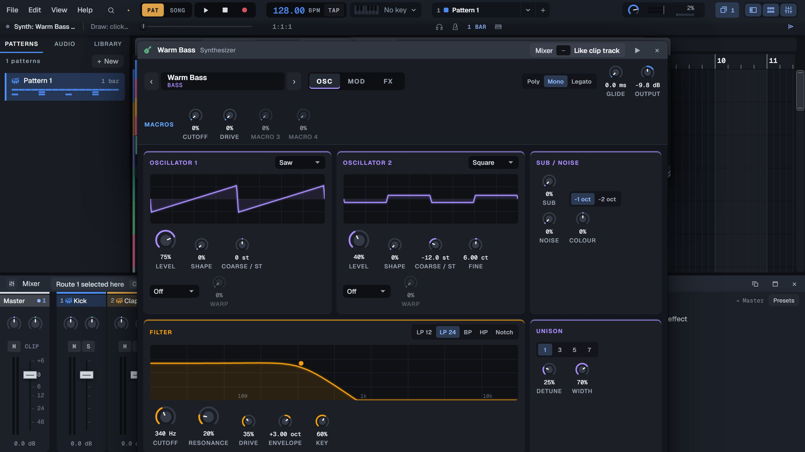 |  |

**Trade-off.** A scrollbar inside the window on small screens. A denser two-column synth
layout would be better but is a design task of its own. Risk: low.

### 4. The pattern dropdown appears up to three times

**Observed.** With the Channel Rack open, the current pattern can be switched from the global
toolbar selector (`Toolbar.tsx:515`), from the Browser's PATTERNS list (`Browser.tsx:187`) and
from a chip in the rack's title bar (`ChannelRack.tsx:462`). The Piano roll adds a fourth
(`PianoRoll.tsx:868`). All of them open the same menu (`patternShared.tsx:240`). Numpad keys,
`F4` and the wheel reach the same action as well.

**Why it matters.** The toolbar is always visible, so the chips add no reach. They add a
second and third place to look, and they make the rack's title bar (8 controls) the densest
header in the app. FL Studio keeps one pattern selector in the toolbar plus the optional
Picker.

**Proposal: Merge.** Keep the toolbar selector (canonical) and the Browser list (overview and
drag source). In the rack and the Piano roll, show the pattern as a plain label so the window
still says what it edits. `Shift`+wheel on the rack title and all pattern keys keep working.

| Before: three dropdowns for "Pattern 1" | After (prototype): one dropdown, one list, one label |
|---|---|
| 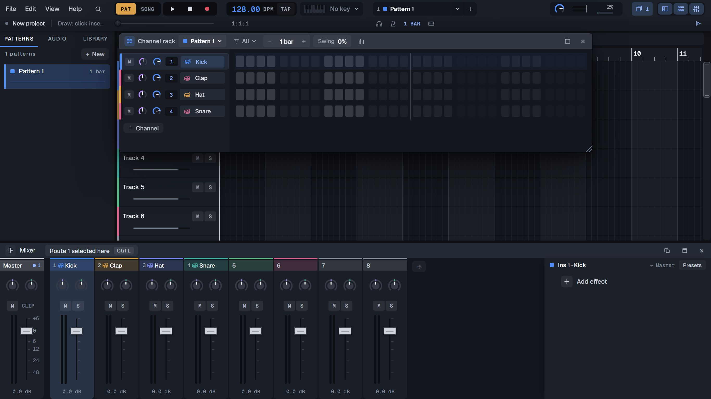 | 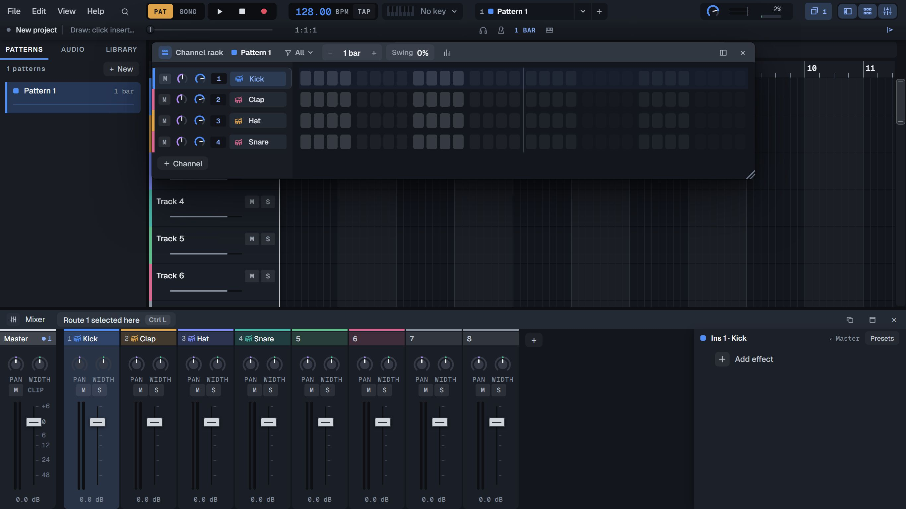 |

| Before: Piano roll title bar | After (prototype) |
|---|---|
| 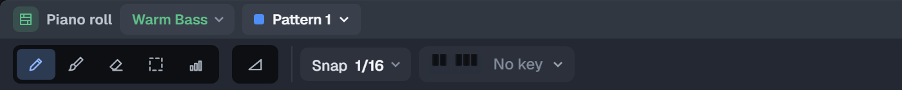 |  |

**Trade-off.** A user working in a maximized Piano roll moves the pointer to the toolbar (or
uses the numpad) to change pattern, and the wheel-over-chip pattern stepping goes with the
chip (the rack keeps `Shift`+wheel on its title bar; the Piano roll has no replacement). Confidence: medium. This is the proposal most worth
checking with real users before merging.

### 5. Split by channel produces names that hide the useful part

**Observed.** *Split by channel* on an untouched "Pattern 1" creates "Pattern 1 – Kick",
"Pattern 1 – Clap", … In the Browser the last one is cut to "Pattern 1 – Warm Ba…", and on
clips at the default zoom every label reads "Pattern 1 – Kic", "Pattern 1 – Cla": the prefix
is identical and the distinguishing word is what gets truncated.

**Proposal: Automate (naming).** If the source pattern still has its default name, name the
parts after the channel only. A pattern the user named keeps "Name – Channel".

| Before | After (prototype) |
|---|---|
| 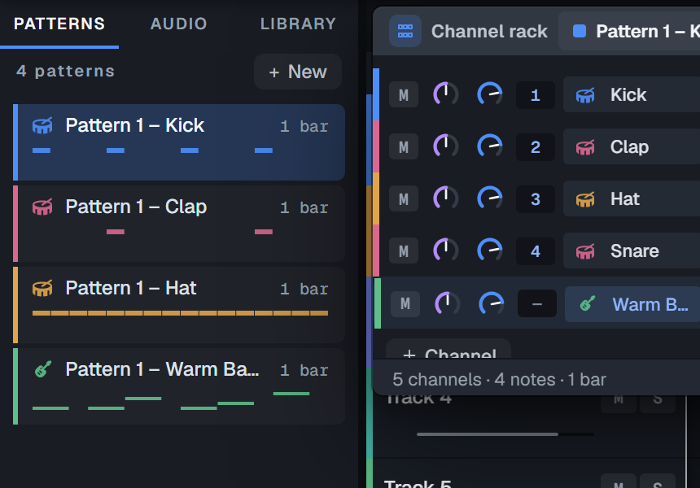 | 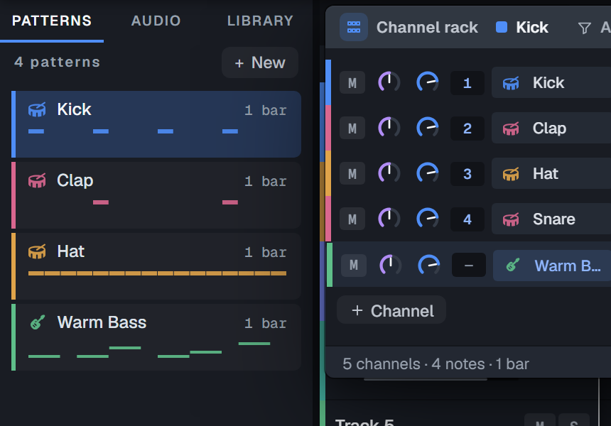 |

Arrangement with those names: [before](ux-audit/before-arranged.jpg) ·
[after](ux-audit/after-arranged.jpg).

**Related, not prototyped.** Tracks keep "Track 1…4" although each holds one instrument and
already shows an inferred icon. Showing the content's name as a dimmed fallback label while the
track still has its default name (derived for display, the project is not modified) would
remove four renames in this journey. Hypothesis: users rename tracks; no data.

**Trade-off.** None found for the split names. Risk: low.

### 6. Track routing has a weaker picker than channel routing

**Observed.** A channel's insert box offers "＋ Free insert (named after it)"
(`ui/src/ui/InsertPicker.tsx:47`, `:77`). A track's *Mixer channel* submenu
(`Playlist.tsx:1600`, `:1626`) offers only the list of inserts, so routing a recorded take
means reading the list to work out which insert is unused. The result is an insert called
"Insert 5"; the strip shows the track's name but the effect-chain header beside it says
"Ins 5 · Insert 5".

**Proposal: Merge behaviour.** One routing vocabulary: the track menu gets the same first
item, which takes the first unused insert (or adds one) and names and colours it after the
track, in one undo step.

| Before | After (prototype) |
|---|---|
| 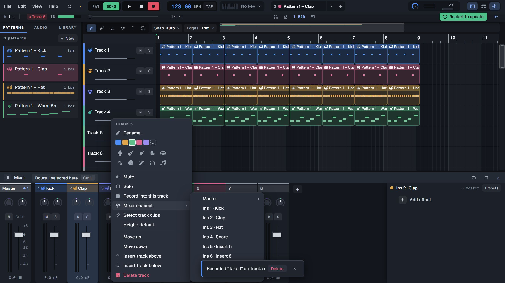 | 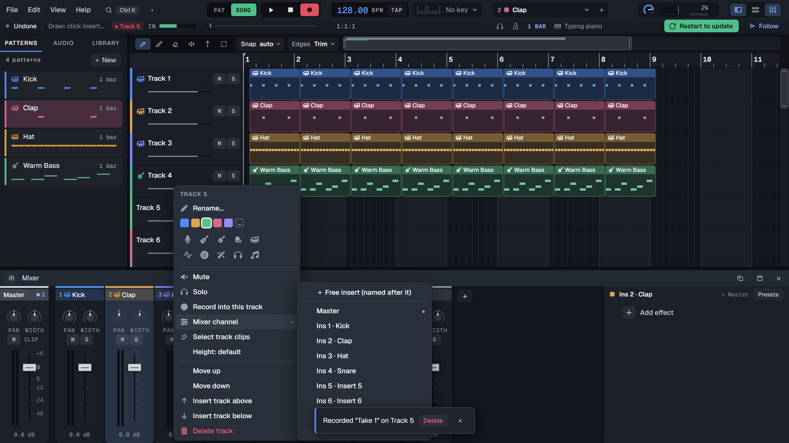 |
| 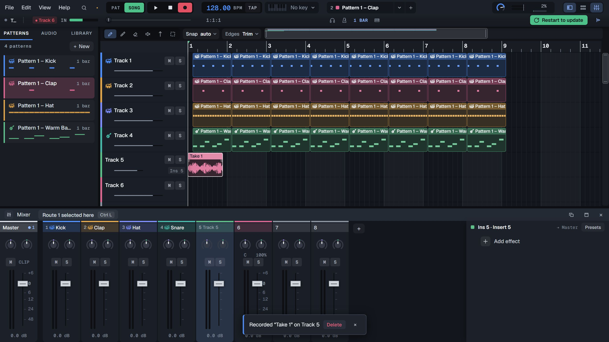 | 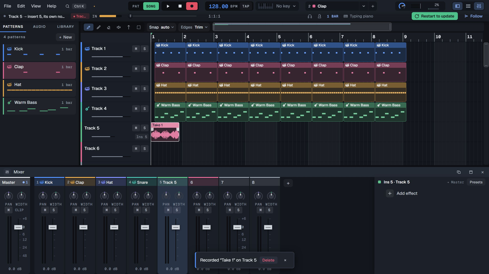 |

| Measure | Before | After |
|---|---|---|
| Actions | 3 | 3 |
| Decisions | which insert is free? | none |
| Labels for the same strip | "Track 5" and "Insert 5" | one name |

**Trade-off.** One more menu row. Risk: low.

### 7. The mixer header advertises a rack action when the rack is closed

**Observed.** "Route 1 selected here · Ctrl L" sits in the mixer's title bar whenever a
Channel Rack channel is selected (`Mixer.tsx:700`). One always is, so the chip is in effect
permanent: it is in every screenshot of this audit, including those where the rack is closed
and the user cannot see what "1 selected" refers to. The same action is in the strip's context
menu, on `Ctrl+L`, and on the rack's insert box.

**Proposal: Contextualize.** Show the chip only while the Channel Rack is on screen.

| Before (rack closed) | After (prototype, rack closed) |
|---|---|
| 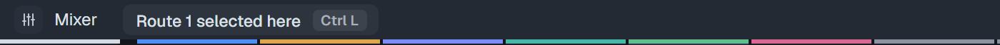 | 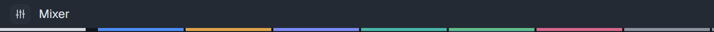 |

**Trade-off.** The chip appears and disappears with the rack; it is in a header, not under the
pointer. Risk: low.

### 8. Channel Rack: "+ Channel" is covered after the fifth channel

**Observed.** Adding a fifth channel to the floating rack makes the footer appear, and the
footer overlaps the "+ Channel" button. The next channel cannot be added comfortably without
resizing the window.

| Before | After (prototype) |
|---|---|
| 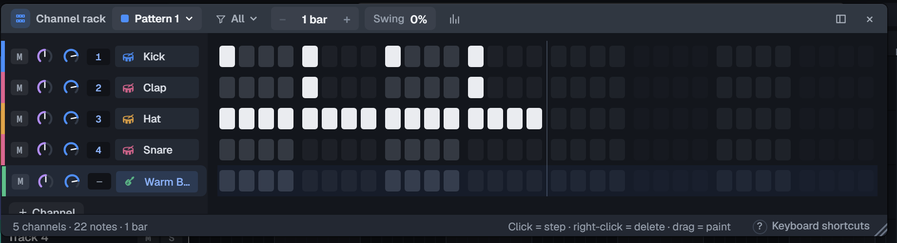 | 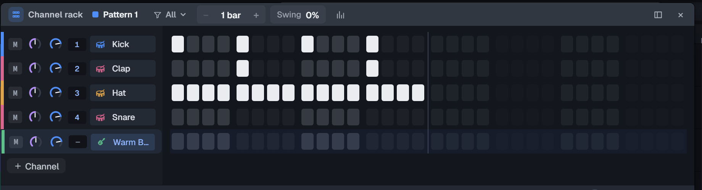 |

This is a defect rather than a design question. Risk: low.

### 9. Two unlabeled dials on every mixer strip

**Observed.** Pan and stereo width are drawn as two identical knobs with no caption
(`Mixer.tsx:308`, `:319`). Their meaning is only in the tooltip; the value appears on hover.
With nine strips that is 18 anonymous controls.

**Why it matters.** Recognition rather than recall: two identical controls with different
meanings have to be learned by position.

**Proposal: label.** A caption under each dial: "PAN" / "WIDTH" at the default value, the value
otherwise. No extra height.

| Before | After (prototype) |
|---|---|
| 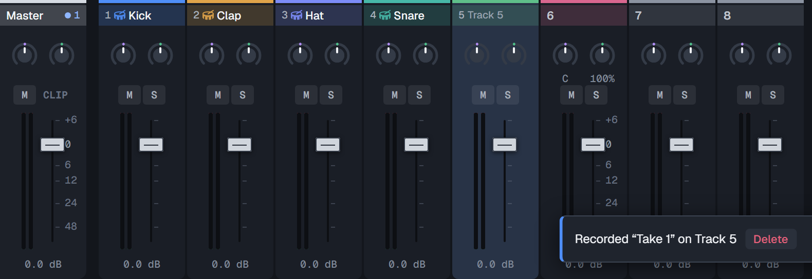 | 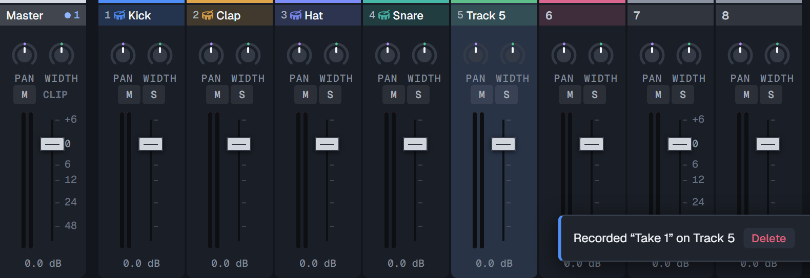 |

**Trade-off.** More text in a dense area. Risk: low.

### 10. Metronome and count-in are also in Settings

**Observed.** Settings → General has a "Recording" section with Metronome and Count-in
(`Settings.tsx:277-280`). The same two switches are on the toolbar, in the View menu, and the
metronome is on `Ctrl+M`. Both rows set the same live transport flags
as the toolbar (`A.setTransportFlag`); they are not separate defaults.

**Proposal: Remove from Settings.** A transport state is not a preference.

| Before | After (prototype) |
|---|---|
| 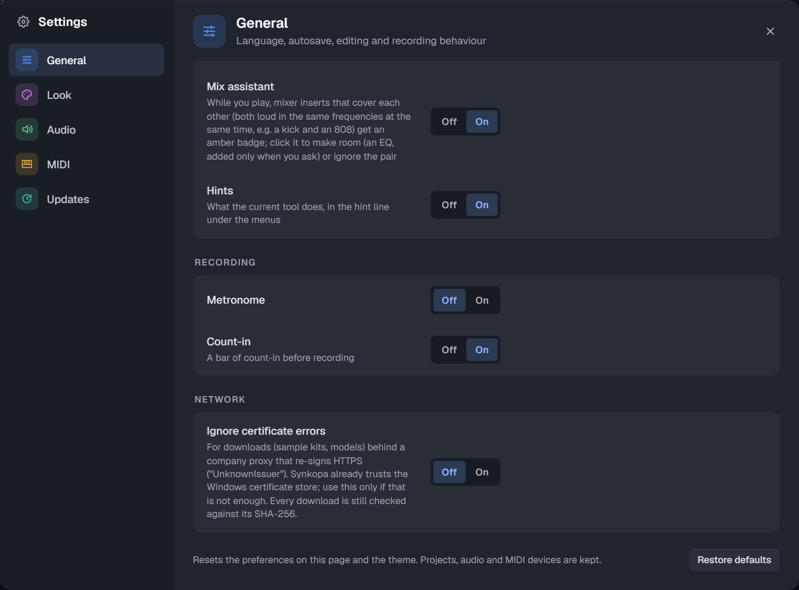 | 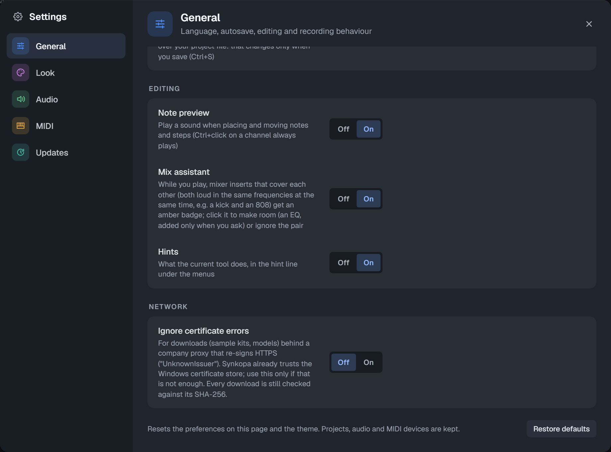 |

**Trade-off.** None if the flags are the same. Risk: low.

### 11. "Ask ChatGPT" holds a labelled slot in the transport row

**Observed.** The toolbar's first row has about 30 permanent controls. One of them is a
labelled "Ask ChatGPT" button (`Toolbar.tsx:202`). It is also `F1`, Help → Ask ChatGPT and a
row in the command palette. It is the first control the toolbar's own fit logic drops
(`styles.css:894`), so it vanishes and reappears as other chips come and go: it was gone in
most frames of the journey because the "windows" chip and the update chip took its room.

**Why it matters.** It does not operate the music, it has three other entry points, and its
appearing and disappearing moves nothing but still changes the bar. The space it frees goes
to the status line of finding 2.

**Proposal: Relocate** to Help, `F1` and the palette only.

| Before | After (prototype) |
|---|---|
| 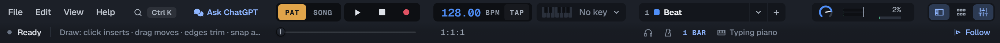 | 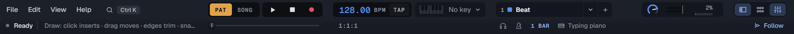 |

**Trade-off.** Lower discoverability of the assistant for first-time users. This is a product
call; no usage data exists. Confidence: medium.

### 12. Nine "+ effect" rows in the maximized mixer

**Observed.** In the maximized mixer every strip carries a ghost "+ effect" row
(`Mixer.tsx:169`), and the chain panel on the right has "Add effect" for the selected insert.
Nine identical buttons were on screen.

**Proposal: Contextualize by selection.** Show the row on the selected strip only (selection,
not hover, so nothing moves under the pointer).

| Before | After (prototype) |
|---|---|
| 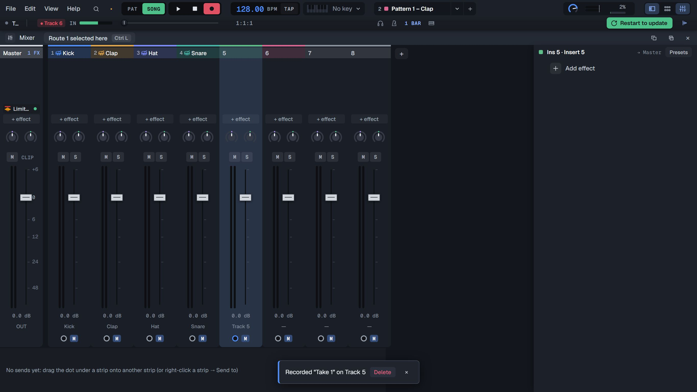 | 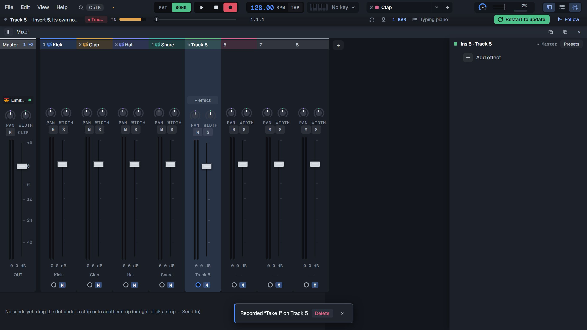 |

**Trade-off.** Adding an effect to another strip costs one extra click to select it first
(`Shift+F9` and the strip menu still work on any strip). Confidence: medium-low; keep it out of
the first batch.

### 13. New instruments get no mixer strip (structural, needs a decision)

**Observed.** A new project's four drum channels are routed to inserts 1–4. A channel added
afterwards has no insert ("—", "via the clip track"), so the new bass played straight to the
Master and had no strip to hold the compressor until it was routed by hand. Two routing models
are in play at once (channel → insert and track → insert), and which one applies depends on
when the channel was created.

**Proposal: Automate.** A new instrument channel takes the first unused insert, named and
coloured after it, in the same undo step as the add; exactly what double-clicking its insert
box does today. "Like clip track" stays available in the picker.

| Before: after "Add channel → Warm Bass" | Mockup: the state the default would produce (reached today with a double-click) |
|---|---|
|  | 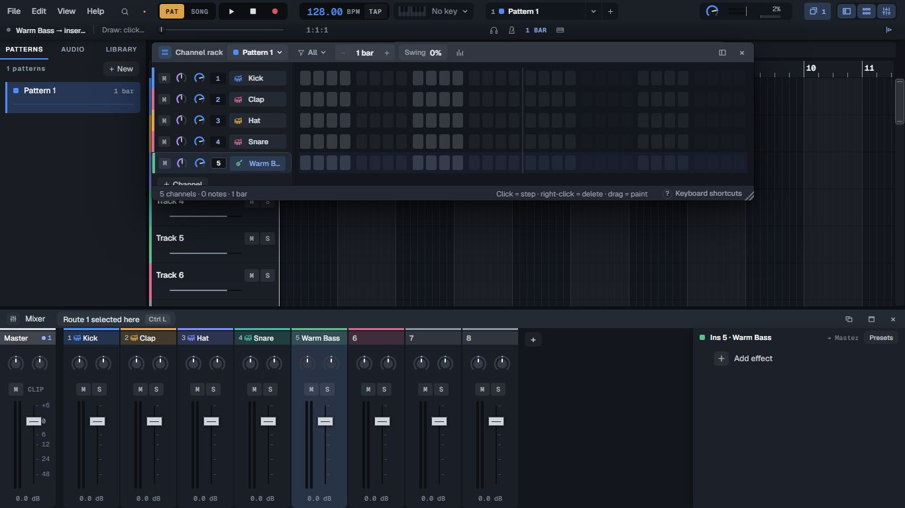 |

**Trade-off.** Routing does not change the sound, but it does change where the channel
appears, and projects that rely on per-track routing for pattern clips behave differently.
This changes an engine default and the mock; it needs your decision, not a quiet patch.

### 14. Adding an instrument is a 32-item, two-level menu (structural)

**Observed.** "+ Channel" opens a menu with 32 rows in four sections and a submenu on most
rows. At 768 px its content is 953 px tall in a 760 px box, so the plugin section is below
the fold. It has no search and no audition. The effect picker next door solves the same
problem with search, categories, favourites and presets.

**Proposal: Merge patterns.** Reuse the effect picker shell for instruments: same search,
same keyboard model, categories from today's menu, presets or samples in the right column,
`Space` to audition.

| Before | Mockup (effect picker shell relabelled; icons are placeholders) |
|---|---|
| 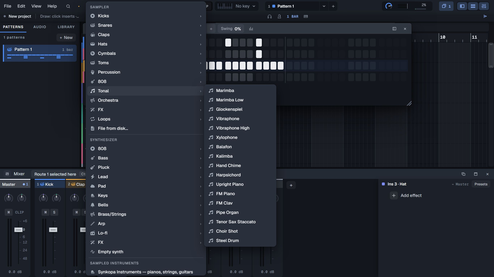 | 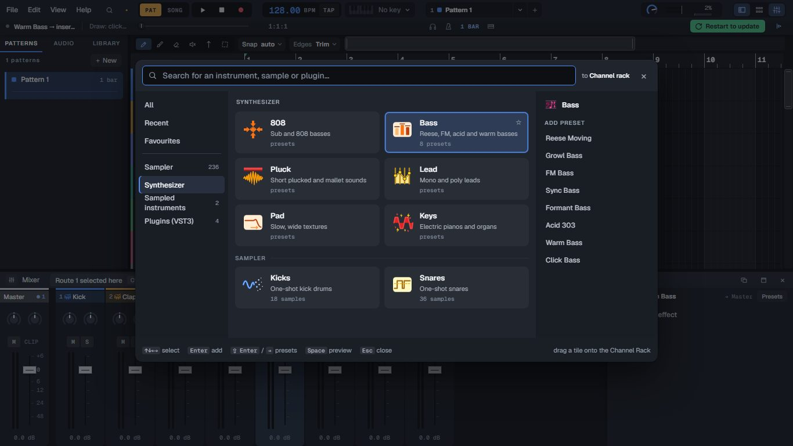 |

| Measure (add "Warm Bass") | Before | After (estimate) |
|---|---|---|
| Actions | 3 (open, hover *Bass*, click) | 3 (open, type "warm", `Enter`) |
| Items to scan | 32, then 8 | results for the typed text |
| Audition before adding | no | yes |

**Trade-off.** A modal picker is heavier than a menu for users who know where an item is.
Effort: medium (new view, reuses `FxPicker`). Hypothesis: search helps more as the library
grows.

### 15. Four empty inserts in every new project (structural, low priority)

**Observed.** A new project has inserts 5–8, unnamed and unused. At 1366 px they take 344 px
of mixer width. Inserts are created on demand anyway ("+", and "＋ Free insert").

| Before | Mockup (same project after removing the unused inserts by hand) |
|---|---|
| 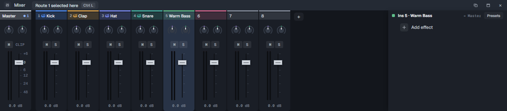 | 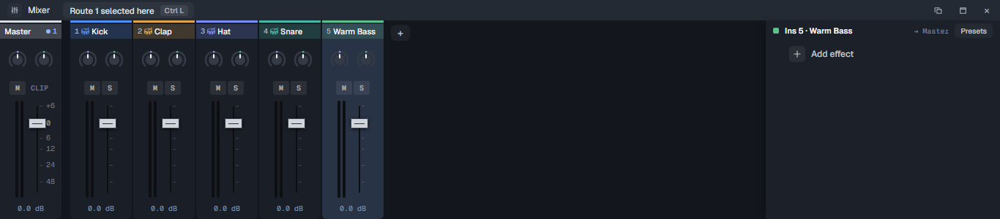 |

**Trade-off.** FL users expect spare inserts to exist. Engine template change. Confidence: low.

## 5. Observed and deliberately left alone

- **Right-click deletes a clip, right-click on its name opens the menu.** It cost a recorded
  take during the audit, but it is the FL convention the product follows. Fix the feedback
  (finding 2), not the gesture.
- **A click on empty playlist space places a clip** with the Draw tool, including a click
  meant only to focus the playlist. FL does the same; undo covers it.
- **The audio-clip menu is long** (17 rows, 668 px, 87% of a 768 px screen). Every row is
  specific to the clip. Reordering or nesting it needs usage data that does not exist.
- **The export dialog** has six rows and remembers its settings. It is not a problem. One
  open question: the first-run default is 32-bit float WAV (`Export.tsx:60`).

  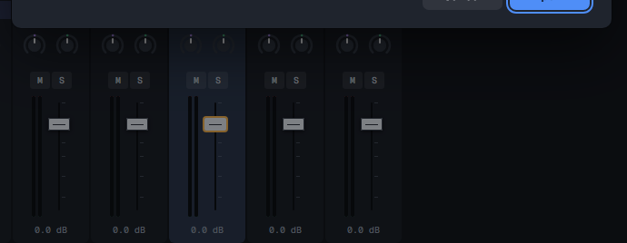
- **Separate tools and snap per editor** (Playlist vs Piano roll) are how FL works.
- **The song-key badge appears in the toolbar and in the Piano roll.** The second one sits
  where scale highlighting is used; it is a contextual entry point, not a duplicate.

## 6. Duplication inventory

Canonical location in bold. "Shortcut" rows are not counted as duplication.

| Action | Entry points | Verdict |
|---|---|---|
| Switch pattern | **toolbar selector**, Browser list, rack chip, Piano roll chip, numpad, wheel | Merge: drop the two chips (finding 4) |
| New pattern | **toolbar "+"**, Browser "New", pattern menu, `F4` | Keep: each sits in a different context |
| Open Channel Rack | **`F6` / toolbar button**, View menu, toolbar pattern name, Browser row click | Contextualize: Browser click no longer opens (finding 1) |
| Channel → insert | **rack insert box**, channel window chip, `Ctrl+L`, strip menu, mixer header chip | Contextualize the chip (finding 7); rest are useful shortcuts |
| Track → insert | **track "Ins n" button**, track menu, clip menu | Keep; give them the free-insert item (finding 6) |
| Add effect | **chain panel "Add effect"**, strip "+ effect" rows, strip menu, `Shift+F9` | Contextualize the strip rows (finding 12) |
| Bypass effect | chain slot LED, strip row LED, effect window power | Keep: same state shown where the effect is shown |
| Metronome / count-in | **toolbar**, View menu, `Ctrl+M`, Settings → General | Remove from Settings (finding 10) |
| Monitor, typing piano, follow | **toolbar**, View menu, shortcut | Keep: the menu is the index of commands and the fallback on narrow windows |
| Ask ChatGPT | toolbar button, **Help menu**, `F1`, palette | Relocate off the toolbar (finding 11) |
| Song key | **toolbar badge**, Piano roll badge | Keep (contextual) |
| Mute / solo, volume / pan | channel, track and insert each have their own | Not duplicates: three different gain stages |
| Export in place | File menu, clip menu, `Ctrl+Alt+E` | Keep |
| Check for updates / What's new | Help menu, Settings → Updates, toolbar chip | Keep |

## 7. Surface-by-surface verdicts

| Surface | Permanent controls | Verdict |
|---|---|---|
| Toolbar | ≈ 30 | Relocate *Ask ChatGPT*; give the status readout priority over the hint. Keep the rest: transport, tempo, key, pattern, master level and window toggles are all per-session staples. |
| Playlist bar | 8 + overview | Keep. |
| Track header | name, M, S, volume, route | Keep; add a derived name fallback (finding 5, related). |
| Channel Rack title | 8 | Merge the pattern chip into a label (→ 7); fix the footer overlap. |
| Piano roll bars | 13–14 | Merge the pattern chip into a label. Tools popover and stamp options are already disclosed on demand. |
| Mixer (docked) | header 3 + chip; 6 per strip | Contextualize the chip; label pan and width. |
| Mixer (maximized) | + route lane | Show "+ effect" on the selected strip only. |
| Browser | 3 tabs + 1–2 per tab | Keep; click selects, double-click opens. |
| Channel / synth window | – | Fit the screen. |
| Sample editor, pitch editor | 6 / ≈ 15 | Keep. Both are dense but every control is in use during the task; no change proposed without user data. |
| Context menus | 12–17 rows | Keep (see section 5). |
| Export, Settings | 6 rows / 5 tabs | Remove the two transport rows from Settings. |
| Docking | float by default, dock on demand | Keep. |

## 8. Backlog

Impact, frequency and confidence: H/M/L. Effort: S (hours), M (days). Risk = regression risk.

**Quick wins**

| # | Change | Impact | Frequency | Confidence | Effort | Risk | Prototype |
|---|---|---|---|---|---|---|---|
| 1 | Browser pattern click selects, double-click opens | H | H | H | S | L | `f6834014` |
| 2 | Status message wins over the hint | H | H | H | S | L | `1addc56d`, `a7b64cc5`, `b4cd7719` |
| 3 | Synth window fits the screen | H | M | H | S | L | `708ee844` |
| 8 | "+ Channel" never covered | M | M | H | S | L | `29f9cd89` |
| 5 | Split names without the default prefix | M | M | H | S | L | `faa87fc2` |
| 6 | "Free insert" in track routing | M | M | H | S | L | `97bcd8e5` |
| 7 | Route chip only with the rack on screen | L | H | H | S | L | `536d351e` |
| 10 | Transport rows out of Settings | L | L | H | S | L | `1e3a7470` |
| 9 | Captions for pan and width | M | H | M | S | L | `859e981e`, `136ff9e4` |
| 4 | One pattern dropdown | M | H | M | S | M | `016edb8e` |
| 11 | *Ask ChatGPT* off the toolbar | L | H | M | S | L | `e77dcbb7` |
| 12 | "+ effect" on the selected strip only | L | M | L | S | M | `90d1ade3` |

**Structural**

| # | Change | Impact | Frequency | Confidence | Effort | Risk |
|---|---|---|---|---|---|---|
| 13 | New instruments get an insert | H | H | M | M | M |
| 2b | "Deleted Take 1 · Undo" toast for recordings | M | L | H | S | L |
| 5b | Derived track names | M | H | M | M | L |
| 14 | Instrument picker with search and audition | M | H | M | M | M |
| 15 | No empty inserts in the template | L | M | L | S | M |

## 9. Prototype verification

On `ux/simplification-prototypes` (13 commits on top of `5e238fed`): `pnpm --dir ui test` 1535 of
1535 passed, `pnpm --dir ui build` clean, Playwright end-to-end 46 of 46 passed. Three
expectations in `ui/e2e/updateStatus.spec.ts` were changed on purpose (finding 2), and the
tests that looked for the toolbar *Ask ChatGPT* button now assert its absence (finding 11). No
Rust code changed, so the cargo gates were not run. The prototypes were exercised only through
the scripted journey above; they have not been tried in the native window.

## 10. Sources

HCI: NN/g, [10 usability heuristics applied to complex applications](https://www.nngroup.com/articles/usability-heuristics-complex-applications/),
[progressive disclosure](https://www.nngroup.com/articles/progressive-disclosure/),
[interaction cost](https://www.nngroup.com/articles/interaction-cost-definition/),
[direct manipulation](https://www.nngroup.com/articles/direct-manipulation/),
[contextual menus](https://www.nngroup.com/articles/contextual-menus/),
[minimize cognitive load](https://www.nngroup.com/articles/minimize-cognitive-load/),
[user control and freedom](https://www.nngroup.com/articles/user-control-and-freedom/),
[Fitts's law](https://www.nngroup.com/articles/fitts-law/); [Hick's law](https://lawsofux.com/hicks-law/).
Keystroke-Level Model operator times: Card, Moran and Newell, *The Psychology of
Human-Computer Interaction* (1983).

DAWs: FL Studio manual, [Channel Rack](https://www.image-line.com/fl-studio-learning/fl-studio-online-manual/html/channelrack.htm),
[mixer track menu (routing, sidechain)](https://www.image-line.com/fl-studio-learning/fl-studio-online-manual/html/mixer_mixermenu.htm),
[automation clips](https://www.image-line.com/fl-studio-learning/fl-studio-online-manual/html/playlist_automationclip.htm),
[browser](https://www.image-line.com/fl-studio-learning/fl-studio-online-manual/html/browser.htm),
[piano roll](https://www.image-line.com/fl-studio-learning/fl-studio-online-manual/html/pianoroll.htm);
Ableton Live 12 manual, [automation](https://www.ableton.com/en/live-manual/12/automation-and-editing-envelopes/)
and [editing MIDI](https://www.ableton.com/en/live-manual/12/editing-midi/);
Bitwig, [sidechaining](https://bitwig.com/learnings/sidechaining-tutorial-49);
Apple, [Logic Pro quick swipe comping](https://support.apple.com/guide/logicpro/lgcp02e40443/mac).

Not sourced, and therefore not relied on: Logic Pro and Studio One toolbar, export and
window-management details; any claim about how often Synkopa features are used.
